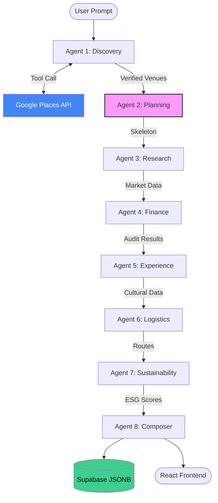
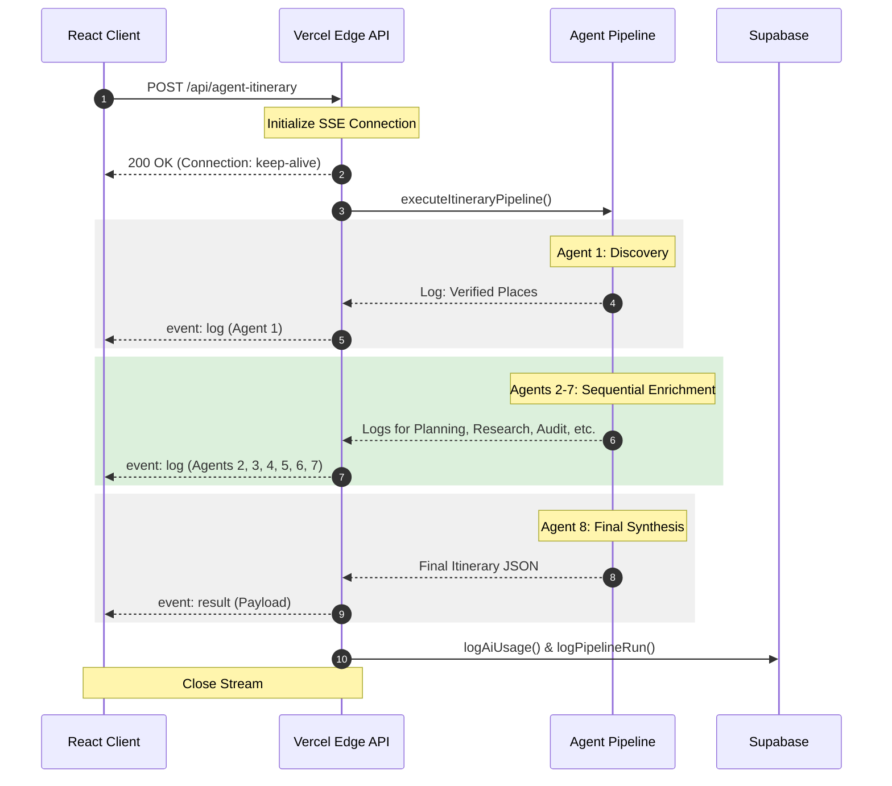
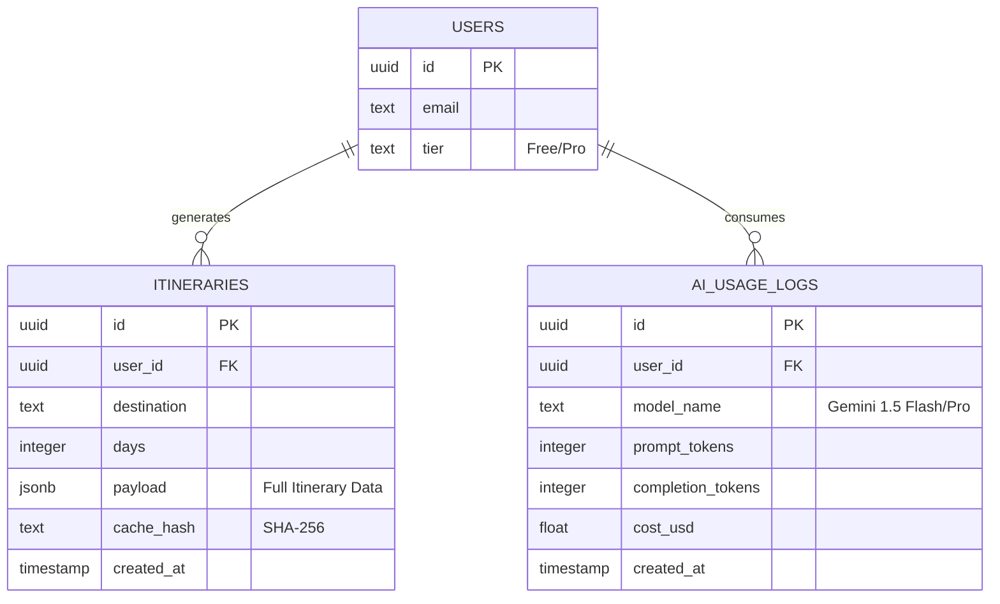
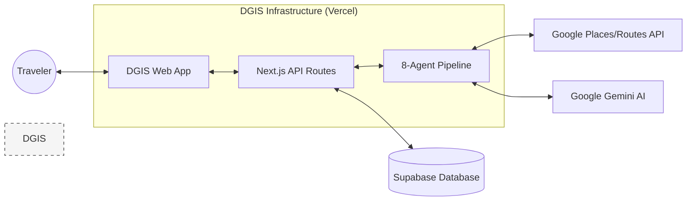

# DGIS: Architectural Diagrams

This document contains the core architectural diagrams for the Data-Grounded Itinerary System (DGIS). These diagrams are written in **Mermaid.js** format and can be rendered directly in GitHub, VS Code, or exported to SVG/PNG for inclusion in the final thesis presentation.

---

## 1. Multi-Agent Pipeline Architecture
This diagram illustrates the 8-agent sequential and parallel flow, showing how data is passed from initial planning to the final verified output.

---

## 2. Server-Sent Events (SSE) Streaming Lifecycle
This sequence diagram shows how the system maintains a persistent connection to prevent serverless timeouts while providing real-time feedback to the user.

---

## 3. Database Schema (ER Diagram)
The system uses a flexible `JSONB` storage pattern to accommodate the complex, multi-dimensional outputs of the agents.

---

## 4. System Context Diagram (C4 Model)
A high-level view of how DGIS sits between the user and external data providers.

