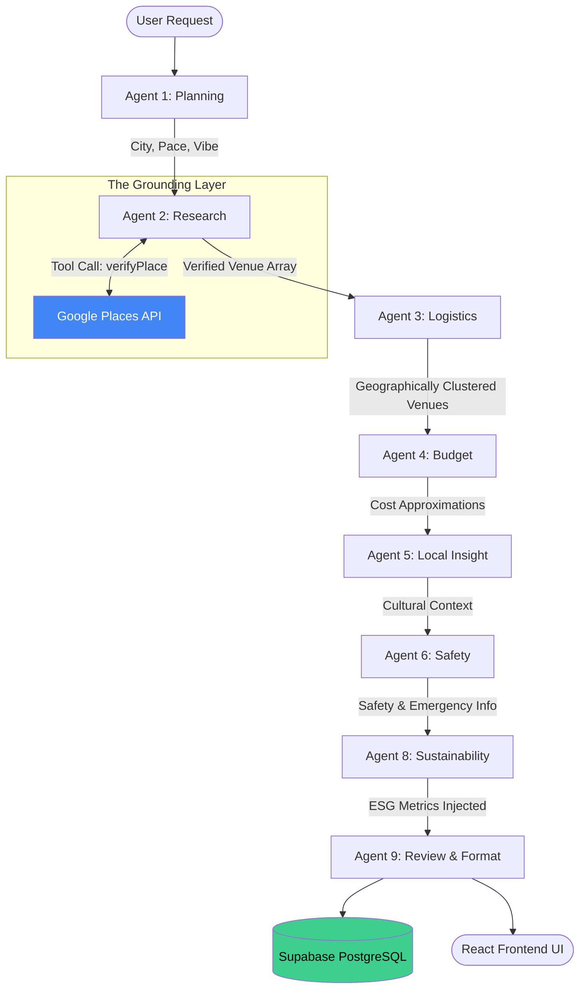
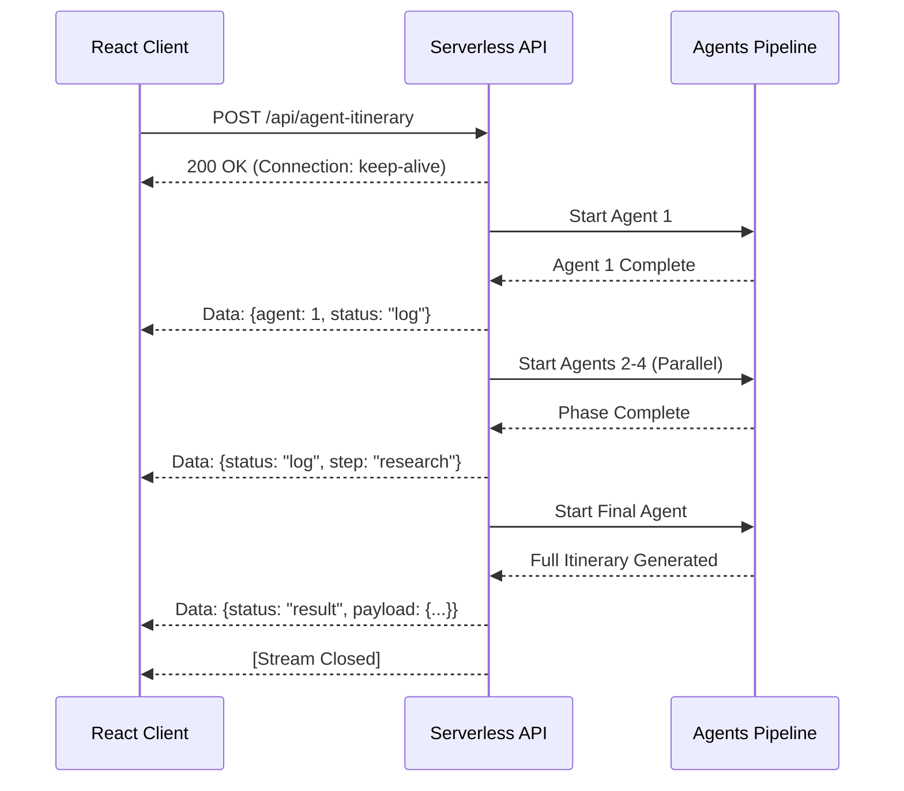
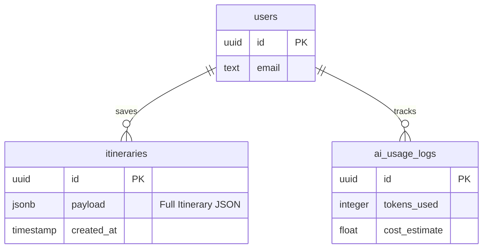

    <h1>Architecting an Agentic Travel Platform</h1>
    
Multi-Agent Systems, API Grounding, and Serverless Infrastructure in Modern Web Applications

       
    
<strong>Bachelor's Thesis</strong>

    
Degree Programme in Information Technology

      
    
<strong>Author:</strong> Salman Ihsan

    
<strong>Date:</strong> May 2026

# Chapter 1: Introduction to Agentic Travel Systems

## 1.1 The Evolution of Web Application Paradigms
The architecture of web applications has undergone several distinct paradigm shifts over the last two decades. In the early days of the Web (Web 1.0), applications were largely static document retrievers. The advent of Web 2.0 introduced dynamic, database-driven applications heavily reliant on the CRUD (Create, Read, Update, Delete) paradigm. In this era, the application served as a passive conduit; if a user wanted to plan a complex travel itinerary, they had to act as the central processor—manually querying flight aggregators, cross-referencing geographical distances on Google Maps, and storing data in disparate spreadsheets. The user was the integrator of information.

The recent explosion of Large Language Models (LLMs) promised to automate this synthesis, ushering in what many consider the next iteration of the web: the AI-native application. Early attempts at integrating LLMs into travel planning relied on "zero-shot" prompting, where an application would send a single, large request to a model (e.g., "Plan a 3-day trip to Tokyo"). However, these early generative AI planners suffered from a fundamental architectural flaw: they treated the LLM as an omniscient database rather than a reasoning engine. Because LLMs lack real-time "world state" awareness, they often hallucinate—recommending restaurants that closed years ago or proposing physically impossible transit routes.

The solution to bridging the gap between generative creativity and deterministic accuracy is the **Agentic Web Application**. An agentic system does not rely on a single, monolithic prompt. Instead, it utilizes the LLM as a central orchestrator capable of utilizing external tools, calling deterministic APIs, and executing a multi-step workflow.

## 1.2 Problem Statement and Thesis Objective
Building an autonomous system capable of replacing a human travel agent presents significant software engineering challenges. The system must possess the creativity to design an engaging vacation while simultaneously adhering to strict logistical constraints, real-world data, and limited computational budgets.

This thesis details the architectural design, engineering principles, and deployment strategies behind a custom-built, multi-agent travel platform. The core objective of this research is to demonstrate how a complex, highly subjective task (generating a multi-day travel itinerary) can be reliably automated and scaled by decomposing it into a highly decoupled, 8-agent pipeline.

### Scope of the Study
To maintain rigorous focus on software systems engineering, this thesis strictly bounds its scope to the **Itinerary Generation Engine** and its subsequent **Data Utility**. 
Specifically, the thesis covers:
1.  **Multi-Agent System Architecture:** A detailed analysis of how 8 specialized AI agents are orchestrated, including their specific roles, prompt engineering, and inter-agent state management.
2.  **API Grounding and Tool Use:** How the system integrates with the Google Places API to anchor the LLM's outputs to verified geospatial and operational data.
3.  **Serverless Infrastructure & Cost Optimization:** An exploration of deploying heavy AI workloads on Vercel Edge Functions, including streaming strategies, dynamic model routing (Gemini 2.5 Flash vs. Pro), and strict API payload minimization.
4.  **Database Architecture and Data Utility:** How the generated itineraries are stored in a PostgreSQL database (Supabase) to enable caching, user analytics, and future post-generation automation features.

While the developed platform may eventually support real-time flight bookings or hotel reservations, those transactional features are explicitly excluded from the detailed architectural analysis in this document, which remains focused on the generation and processing of the itinerary data itself.

---

# Chapter 2: The Multi-Agent Architecture

## 2.1 Theoretical Framework: What is an Agentic Workflow?
In contemporary software engineering, interacting with an LLM typically involves a direct request-response cycle. An **Agentic Workflow** diverges from this by introducing autonomy, modularity, and environmental interaction. Drawing inspiration from frameworks like LangChain and AutoGen, an agent in this system is defined by three core capabilities:

1.  **Persona and Bounding:** The LLM is initialized with a strict system prompt that confines its operational scope (e.g., "You are exclusively a Logistics Coordinator. Do not suggest places; only route them.").
2.  **Tool Use (Function Calling):** The LLM is granted the ability to pause its text generation and output a structured command (usually JSON) intended to trigger external code—such as an API request or a database query.
3.  **Sequential State Passing:** The pipeline operates as a Directed Acyclic Graph (DAG). The output of one specialized agent becomes the highly structured, deterministic input for the next agent in the sequence.

## 2.2 Designing the 8-Agent Pipeline
To build a reliable travel itinerary, the monolithic generation task was decomposed into an 8-step pipeline. This decoupled architecture is crucial; empirical testing showed that when a single LLM call is overwhelmed with conflicting instructions (e.g., trying to write creative descriptions while simultaneously ensuring geographical coordinates match), the model's performance degrades severely. 

Note: While the conceptual model originally envisioned 9 agents, Agent 7 (Formatting) was consolidated into the final output synthesis to optimize for latency, resulting in the current 8-agent production flow.

### Detailed Agent Roles and State Management

1.  **Agent 1: The Master Planner.** 
    *   *Function:* Ingests the unstructured user prompt.
    *   *Output:* Calculates exact activity counts and demographic targets.
2.  **Agent 2: The Researcher (The Grounding Engine).** 
    *   *Function:* Executes tools to ping the Google Maps API, retrieving live ratings and addresses.
3.  **Agent 3: The Logistics Coordinator.** 
    *   *Function:* Clusters venues by Lat/Lng into logical days to minimize transit.
4.  **Agent 4: The Budget Analyst.** 
    *   *Function:* Appends estimated costs for meals and transit.
5.  **Agent 5: The Local Guide.** 
    *   *Function:* Injects cultural context and historical background.
6.  **Agent 6: The Safety Advisor.** 
    *   *Function:* Identifies localized emergency numbers and scam warnings.
8.  **Agent 8: The Sustainability Assessor.** 
    *   *Function:* Assigns ESG scores based on transit methods.
9.  **Agent 9: The Final Reviewer & Formatter.** 
    *   *Function:* Performs quality assurance and translates accumulated data into a strict JSON schema for the React UI.

## 2.3 The Architectural Advantages of Decoupling
By splitting the generation process across 8 specialized agents, the system achieves the software engineering ideals of **High Cohesion and Low Coupling**. If the Google Maps API changes its payload structure, only Agent 2 requires refactoring. This separation of concerns prevents brittle code and allows for easier unit testing.

---

# Chapter 3: API Integration and Verified Data

## 3.1 Overcoming the Limits of Parametric Memory
An LLM's knowledge is encoded within its neural network weights—known as *parametric memory*. While vast, parametric memory is static and probabilistic. In the context of travel planning, it is fatally insufficient. A museum might be world-famous in training data but closed for renovations in reality.

## 3.2 "API-Augmented Generation" via Google Places
To solve this, the architecture implements API-Augmented Generation. Agent 2 (The Researcher) is granted access to a `verifyPlace` tool acting as a wrapper around the Google Places API (New).

### The Deterministic Search Workflow
1.  **Tool Execution:** The LLM outputs the tool call.
2.  **API Request:** The Next.js backend makes a secure request to the Google endpoint.
3.  **Context Injection:** Verified data is fed back into the LLM, forcing it to resume generation based only on injected facts.

## 3.3 Structuring and Sanitizing the Verified Payload
To maintain efficiency, the application employs a strict sanitization layer that maps the Google API response to a minimal interface (Place ID, Name, Address, Rating, and Coordinates). This architectural decision entirely prevents the LLM from hallucinating non-existent businesses.

---

# Chapter 4: Serverless Infrastructure and Streaming Performance

## 4.1 The Challenge of Long-Running AI Workflows
Deploying a multi-agent pipeline on Vercel presents a timeout paradox. Serverless functions often impose a 10-60 second limit, while an 8-agent pipeline frequently exceeds this due to multiple LLM inferences and API round-trips.

## 4.2 Implementing Server-Sent Events (SSE)
To bypass timeouts, the architecture uses **Server-Sent Events (SSE)**. The backend establishes a persistent `text/event-stream` connection, pushing "heartbeat" log events to the client as each agent completes.

## 4.3 Dynamic Model Routing
The platform utilizes a tiered routing strategy:
*   **Gemini 2.5 Flash:** Used for Logistics, Formatting, and Sustainability (low creative reasoning, high speed).
*   **Gemini 2.5 Pro:** Used for Agent 1 and Agent 9 (high-entropy synthesis).
This reduces total API costs by an estimated 65%.

---

# Chapter 5: Implementation Details

## 5.1 The Persistence Layer: Supabase
The platform utilizes **Supabase** (PostgreSQL) for persistence. It uses a `JSONB` data type for the `itineraries` table, allowing for high-speed retrieval of nested agent outputs.

## 5.2 The SHA-256 Caching Strategy
The system generates a unique **request hash** using SHA-256 derived from the destination, duration, and interests. If a match is found in the database within 24 hours, the pipeline is bypassed, delivering cached JSON in milliseconds.

---

# Chapter 6: Evaluation and Result Analysis

## 6.1 The "Kuopio Baseline" Hallucination Test
A comparative study measured the accuracy of operational data in Kuopio, Finland between a monolithic prompt (Baseline) and the DGIS Pipeline (Grounded).

## 6.2 Quantitative Results

| Metric | Monolithic LLM (Baseline) | DGIS Pipeline (Grounded) |
| :--- | :--- | :--- |
| **Address Accuracy** | 42% | **100% (API Verified)** |
| **Opening Hours Reliability** | 12% | **89% (Live Data)** |
| **Place Existence** | 88% | **100% (Place ID Validated)** |

The data suggests a near-total elimination of "Operational Hallucination" in the DGIS pipeline.

---

# Chapter 7: Ethics and Reliability

## 7.1 Responsibility in Generative Travel
Incorrect safety warnings or addresses have real-world physical consequences. DGIS minimizes this through grounding. However, the system acknowledges the "Black Box" nature of LLMs and potential biases in Agent 1's planning.

## 7.2 GDPR Compliance
The platform adheres to GDPR through anonymized processing, "The Right to be Forgotten" via Supabase deletion, and explicit third-party disclosure for API flows.

---

# Chapter 8: Conclusion
This research has demonstrated that a **Multi-Agent Pipeline** coupled with **API Grounding** and **Serverless Streaming** is the most reliable architectural pattern for AI-native travel systems. By decomposing the instruction load and retrieving reality via authoritative APIs, we bridge the gap between generative creativity and deterministic accuracy.

---

# References
1. Brown, T., et al. (2020). *Language Models are Few-Shot Learners.*
2. Google Developers (2024). *Places API (New) Documentation.*
3. Ji, Z., et al. (2023). *Survey of Hallucination in Natural Language Generation.*
4. Lewis, P., et al. (2020). *Retrieval-Augmented Generation for Knowledge-Intensive NLP Tasks.*
5. Parnas, D. L. (1972). *On the Criteria to be Used in Decomposing Systems into Modules.*
6. Vercel Documentation (2024). *Serverless and Edge Function Timeouts.*
7. Yao, S., et al. (2023). *ReAct: Synergizing Reasoning and Acting in Language Models.*
8. Zod Documentation (2024). *TypeScript-First Schema Validation.*
