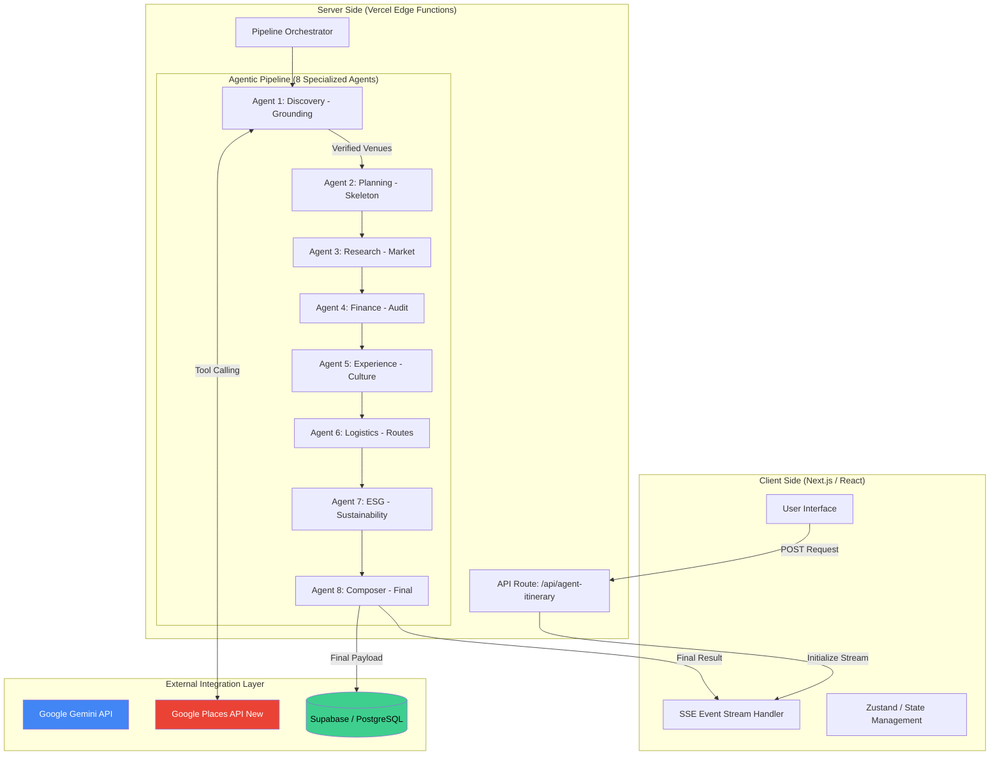
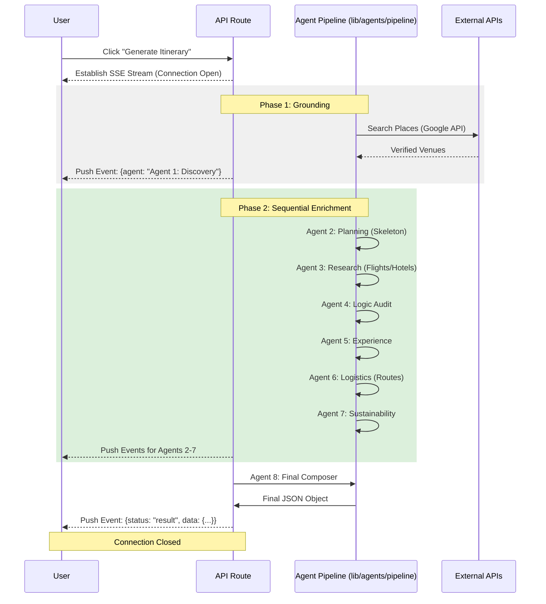

# DGIS Technical System Design

This document provides a comprehensive technical overview of how the **Data-Grounded Itinerary System (DGIS)** is architected. It details the connection between the React frontend, the Next.js serverless backend, the multi-agent pipeline, and external service integrations.

---

## 1. System Architecture Overview
The system follows a **Modular Agentic Pipeline** architecture. Unlike traditional LLM apps that use a single prompt, DGIS decomposes the request into discrete functional units.

---

## 2. The Data Flow (The "Blackboard" Pattern)
DGIS uses a **Blackboard Pattern** where a central state object is passed between agents. Each agent "contributes" its expertise to the object until it is complete.

| Phase | Agents Involved | Purpose | State Contribution |
| :--- | :--- | :--- | :--- |
| **Phase 1** | Agent 1 | Discovery & Grounding | Verified Place Pool (Grounding Engine) |
| **Phase 2** | Agent 2 | Planning & Strategy | Itinerary Skeleton (Cities, Days) |
| **Phase 3** | Agent 3, 4 | Research & Finance | Real Pricing (Flights/Hotels) & Logical Audit |
| **Phase 4** | Agent 5, 6, 7 | Enrichment & Logistics | Culture, Routes, and Sustainability (ESG) |
| **Phase 5** | Agent 8 | Final Synthesis | Polished Narrative & Creative Content |

---

## 3. File-Level Architecture (The "Code Connection")

If you are looking at the repository, here is how the files connect:

### 1. The Entry Point
`src/app/api/agent-itinerary/route.ts`
- **Role:** Handles the HTTP POST request.
- **Responsibility:** Sets up the `TransformStream` for SSE and initiates the `runAgentPipeline` function.

### 2. The Orchestration Logic
`src/lib/agents/pipeline.ts`
- **Role:** Manages the sequential pipeline execution.
- **Responsibility:** Chains the 8 agents, ensuring data dependencies (e.g., Finance Audit depends on Research results) are respected.

### 3. The Agent Definitions
`src/app/api/agent-itinerary/agents/`
- `agent1.ts`: Discovery - Acquires grounding data from Google Places.
- `agent2.ts`: Planning - Generates the high-level skeleton.
- `agent3.ts`: Research - Procures flight and hotel options.
- `agent4.ts`: Logic Checker - Performs structural and financial audits.
- `agent5.ts`: Experience - Adds cultural and local insights.
- `agent6.ts`: Logistics - Optimizes routes and travel times.
- `agent7.ts`: Sustainability - Calculates ESG scores.
- `agent8.ts`: Composer - Finalizes the narrative and assembly.

### 4. The Tooling Layer
`src/utils/google-maps.ts`
- **Role:** Secure wrapper for Google Places API.
- **Responsibility:** Sanitizes the massive Google JSON response into a small `VerifiedPlace` object.

---

## 4. Sequence Diagram: One Request Journey
This diagram shows the "Handshake" and execution flow.

---

## 5. Summary for Thesis Presentation
When presenting this architecture, emphasize these **3 Key Engineering Principles**:
1.  **Strict State Isolation:** Agents cannot talk to each other directly; they only update the shared Blackboard object.
2.  **Sequential Integrity:** The pipeline follows a strict dependency chain (e.g., Grounding -> Planning -> Research -> Audit) to ensure high data fidelity.
3.  **Deterministic Grounding:** All "Hallucination Risk" is eliminated by the Grounding Engine (Agent 1), which forces the LLM to only use verified venues from the Google Places API.
