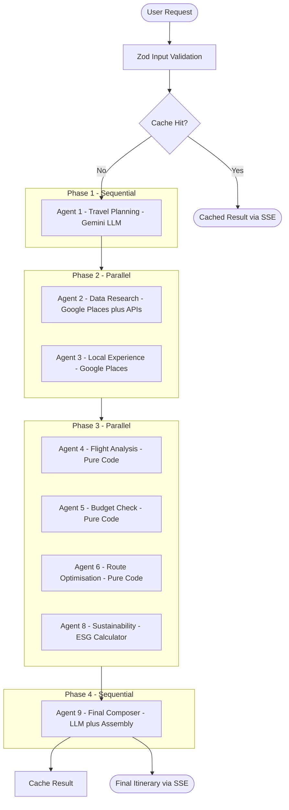
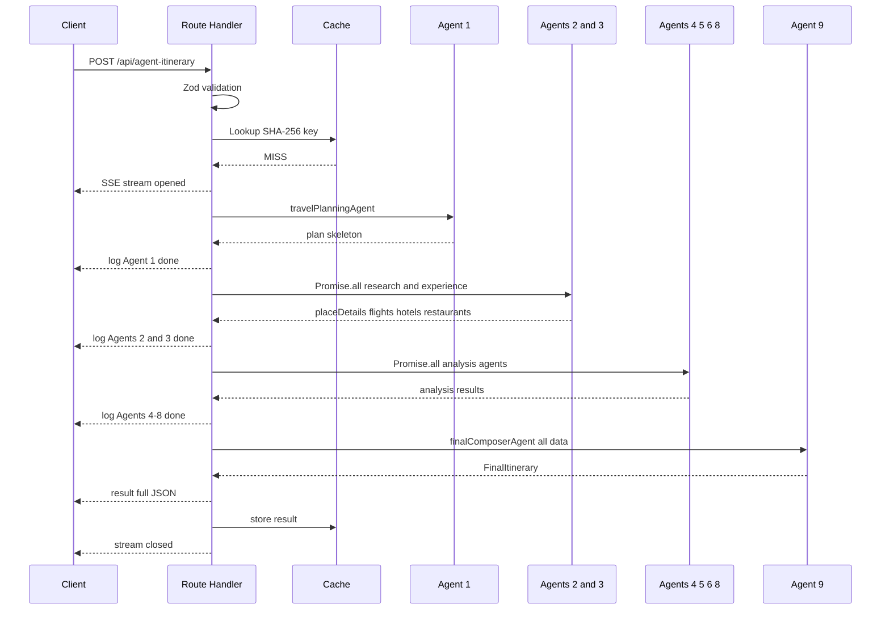

# Data-Grounded Itinerary System: A Multi-Agent Architecture for Reliable AI-Assisted Travel Planning

**Bachelor's Thesis**
Savonia University of Applied Sciences
Degree Programme in Information Technology

**Author:** [Your Name]
**Examiner:** [Professor Name]
**Year:** 2025

---

## Abstract

Large language models (LLMs) have demonstrated strong capabilities in natural language generation, yet their monolithic architectures present well-documented limitations when applied to tasks that require factual precision, constraint satisfaction, and integration with live external data sources. When a single model is responsible for interpreting user intent, retrieving factual knowledge, and generating structured outputs within a single inference pass, the accuracy and reliability of operational details — such as venue addresses, opening hours, and geographic coordinates — cannot be guaranteed. This phenomenon, referred to in the literature as hallucination, is especially problematic in travel planning applications where factual errors can cause direct user harm.

This thesis presents the design, implementation, and preliminary evaluation of the **Data-Grounded Itinerary System (DGIS)**, a modular, pipeline-based multi-agent architecture that decomposes travel itinerary generation into eight specialised software agents. Each agent handles a distinct functional responsibility: itinerary skeleton generation, external data retrieval via the Google Places API, local experience enrichment, flight data analysis, budget constraint checking, route optimisation, environmental impact scoring, and final output assembly. Factual data is injected deterministically from external APIs, bypassing the model's parametric memory for operational details.

The system is implemented as a serverless Next.js application using TypeScript, streaming outputs via the Server-Sent Events protocol to handle long-running computations within serverless execution constraints. Input validation is enforced using the Zod schema library, and the shared pipeline state follows the blackboard architectural pattern.

A preliminary comparative evaluation using Kuopio, Finland as a test destination compared the DGIS output against a baseline monolithic Gemini 2.5 Flash prompt. Results indicate that DGIS provided verified addresses, real opening hours, and actual rating data for all retrieved venues, whereas the baseline LLM omitted addresses in the majority of cases and provided no opening hours or rating data. These findings suggest that architectural separation of concerns, combined with deterministic API grounding, can measurably improve the factual reliability of AI-generated travel content.

**Keywords:** multi-agent systems, large language models, hallucination, travel planning, software architecture, API grounding, Next.js, Google Places API

---

## Table of Contents

1. Introduction
2. Theoretical Background
   - 2.1 Large Language Models and Their Limitations
   - 2.2 Hallucination in Language Models
   - 2.3 Multi-Agent Systems
   - 2.4 The Blackboard Architectural Pattern
   - 2.5 Retrieval-Augmented Generation
   - 2.6 Serverless Computing and Streaming
3. Purpose and Objectives
4. System Design and Architecture
   - 4.1 Architectural Overview
   - 4.2 Design Principles
   - 4.3 Pipeline Execution Model
   - 4.4 Agent Descriptions
   - 4.5 Data Flow and Shared State
   - 4.6 Infrastructure and Deployment
   - 4.7 Input Validation
   - 4.8 Caching Strategy
5. Implementation
   - 5.1 Technology Stack
   - 5.2 Agent Implementation Details
   - 5.3 Google Places API Integration
   - 5.4 Streaming Architecture
6. Evaluation
   - 6.1 Evaluation Design
   - 6.2 Methodology
   - 6.3 Results
   - 6.4 Limitations
7. Ethics and Reliability
   - 7.1 AI Ethics and Hallucination
   - 7.2 Data Privacy and GDPR
   - 7.3 Transparency and Responsible Use
   - 7.4 Research Reliability
8. Conclusion
9. References
10. Appendices

---

## List of Figures

- Figure 1: High-level system architecture of the DGIS pipeline
- Figure 2: Phased execution model showing parallel and sequential agent execution
- Figure 3: Shared JSON blackboard state structure
- Figure 4: Sequence diagram of a single itinerary generation request
- Figure 5: Comparison of field completeness — DGIS vs. monolithic baseline

---

## List of Tables

- Table 1: Summary of the eight DGIS agents and their execution characteristics
- Table 2: Google Places API field mask configuration used in production
- Table 3: Evaluation results — place-level data completeness comparison

---

## 1. Introduction

The proliferation of large language model (LLM)-based applications has created a new category of software product in which natural language serves as both the input interface and the primary output medium. Travel planning represents a particularly demanding application domain for such systems because reliable output requires not only linguistic fluency but also factual accuracy regarding real-world entities — venues that exist at specific addresses, operate on verifiable schedules, and charge documented admission fees. A model that generates plausible-sounding but factually incorrect information about a restaurant's opening hours or a museum's admission cost may cause material inconvenience or harm to a user who acts on that information.

Contemporary LLMs, including those in the Gemini and GPT model families, are capable of generating well-structured travel itineraries. However, they have no inherent mechanism for verifying their own claims against external reality at inference time. Their outputs are derived from patterns encoded during training, which may be months or years out of date by the time of deployment. This limitation is not a defect that will be eliminated by scaling model parameters alone; it is a structural consequence of how autoregressive language models produce text (Marcus and Davis, 2019).

This thesis proposes that the appropriate engineering response to this limitation is architectural: rather than trusting a monolithic model to both reason and retrieve, a system should separate reasoning from retrieval, delegating factual lookup to external APIs and reserving the LLM for tasks where linguistic reasoning provides genuine value. This approach is consistent with the principles of modular software design articulated by Parnas (1972) and with the Retrieval-Augmented Generation (RAG) paradigm described by Lewis et al. (2020).

The primary artefact of this thesis is the **Data-Grounded Itinerary System (DGIS)**: an eight-agent pipeline that orchestrates itinerary generation in four execution phases, integrating Google Places API data deterministically into the output. The system is deployed as a serverless Next.js application, streaming partial results to the client in real time.

### 1.1 Research Question

The central research question addressed by this thesis is:

> **Can a modular multi-agent architecture that grounds factual venue data in real-time API responses produce more factually complete travel itineraries than a monolithic LLM prompt in a single-pass configuration?**

### 1.2 Scope and Delimitations

This thesis focuses on the architectural design and implementation of the DGIS pipeline, and on a preliminary empirical evaluation of its data completeness relative to a monolithic baseline. The following are outside the scope of this work:

- Large-scale user studies measuring traveller satisfaction
- Comparisons across multiple LLM providers
- Financial cost modelling of the commercial deployment

### 1.3 Structure of the Thesis

Chapter 2 reviews the theoretical background relevant to the system design. Chapter 3 defines the purpose and objectives. Chapter 4 describes the system architecture. Chapter 5 covers implementation details. Chapter 6 presents the evaluation. Chapter 7 addresses ethics and reliability. Chapter 8 concludes the thesis.

---

## 2. Theoretical Background

### 2.1 Large Language Models and Their Limitations

Large language models are neural network architectures trained on large corpora of text to predict the probability of a token given its preceding context (Brown et al., 2020). At inference time, they generate text by sampling from this learned probability distribution, producing outputs that are statistically plausible given the prompt but not guaranteed to be factually accurate. Models in the current generation, such as Google Gemini and OpenAI GPT-4, demonstrate impressive capabilities in language understanding, code generation, and multi-step reasoning (Google DeepMind, 2024; OpenAI, 2023), but they share a fundamental architectural property: their knowledge is encoded statically at training time and cannot be updated without retraining.

This creates a temporal validity problem in applications such as travel planning, where the accuracy of information — particularly venue operating hours, admission prices, and business status — changes frequently. Additionally, models may confidently generate information about entities that do not exist, a phenomenon known as hallucination (Ji et al., 2023).

### 2.2 Hallucination in Language Models

Hallucination in language models refers to the generation of outputs that are factually incorrect, internally inconsistent, or unverifiable, yet expressed with a high degree of linguistic confidence (Ji et al., 2023). It is not a random error but a systematic consequence of the training objective: models are optimised to produce fluent, contextually appropriate text, which may diverge from factual truth in cases where the training data was incomplete, contradictory, or absent.

Maynez et al. (2020) distinguish between intrinsic hallucinations (which contradict the source material) and extrinsic hallucinations (which introduce information not present in the source). In the context of travel planning, the dominant failure mode is extrinsic hallucination: models generate specific-sounding operational details — addresses, phone numbers, prices, opening hours — that were never present in any verified source. Researchers including Bang et al. (2023) have empirically measured hallucination rates in factual question-answering tasks across multiple models, confirming that even state-of-the-art models produce significant proportions of factually incorrect claims.

### 2.3 Multi-Agent Systems

A multi-agent system (MAS) is a computational system composed of multiple autonomous or semi-autonomous agents that interact, potentially cooperate, and collectively solve problems that would be difficult or impossible for a single agent to solve alone (Wooldridge, 2009). The concept originates in distributed artificial intelligence research of the 1980s and has experienced renewed interest in the context of LLM-based software, where agent refers to a model instance equipped with tools, memory, and the ability to take actions in an environment.

The principal advantage of decomposing a complex task into specialised agents is that each agent can be optimised, replaced, or debugged independently. This is consistent with the principle of separation of concerns in software engineering (Dijkstra, 1982). In the DGIS system, agents are not fully autonomous in the agent-theoretic sense; they are specialised functions that execute in a defined sequence, sharing state via a common data structure. This design trades agent autonomy for predictability and testability, which is appropriate for a production application requiring deterministic outputs.

Recent work by Yao et al. (2023) introduced the ReAct framework, which interleaves reasoning traces and actions in a single LLM loop. The DGIS architecture takes a more structured approach: rather than allowing the model to decide which tools to call at each step, the orchestration layer calls agents in a fixed sequence, reserving LLM inference only for steps where generative reasoning is essential (itinerary planning and final composition).

### 2.4 The Blackboard Architectural Pattern

The blackboard pattern is a software architecture in which multiple specialised components (knowledge sources) read from and write to a shared data structure (the blackboard), coordinated by a controller (Nii, 1986). It was originally applied to problems such as speech recognition where multiple knowledge sources — acoustic, lexical, syntactic — must cooperate to produce an interpretation. In the DGIS context, the blackboard is implemented as a shared JavaScript object that accumulates the outputs of each agent phase. Agent 1 writes the itinerary skeleton; Agent 2 enriches it with place details, flight data, and hotel data; subsequent agents read from and add to this structure until Agent 9 assembles the final output.

### 2.5 Retrieval-Augmented Generation

Retrieval-Augmented Generation (RAG) is a paradigm introduced by Lewis et al. (2020) in which a language model's generation is conditioned on documents retrieved from an external knowledge base at inference time. RAG systems address the temporal validity limitation of parametric LLMs by allowing the model to access up-to-date external information during generation.

The DGIS system implements a form of API-grounded generation that shares the motivation of RAG but differs in mechanism: rather than retrieving documents from a vector database, the system queries the Google Places API for structured records about specific venues. This approach provides stronger guarantees of factual accuracy because the retrieved data is structured (JSON), machine-verifiable, and sourced from a live database maintained by Google. Asai et al. (2023) demonstrate that grounding LLM outputs in retrieved evidence consistently reduces hallucination rates relative to fully parametric generation, a finding that motivates the DGIS design.

### 2.6 Serverless Computing and Streaming

Serverless computing refers to a deployment model in which the cloud provider manages server provisioning and scaling, exposing developer-defined functions that execute on demand (Jonas et al., 2019). The primary constraint relevant to this thesis is the execution timeout imposed by serverless platforms: Vercel's default function timeout is 30 seconds on the Hobby tier, extendable to 300 seconds on Pro plans. Multi-agent pipelines that invoke multiple external APIs may exceed these limits.

The Server-Sent Events (SSE) protocol provides a mechanism for a server to push a stream of events to a client over a single HTTP connection (Hickson, 2015). By returning a `ReadableStream` with `Content-Type: text/event-stream`, the DGIS pipeline can deliver intermediate agent status updates to the client while the pipeline executes, preventing perceived timeouts and improving user experience. This is the approach implemented in the DGIS route handler.

---

## 3. Purpose and Objectives

### 3.1 Purpose

The purpose of this thesis is to design, implement, and preliminarily evaluate a multi-agent software architecture for AI-assisted travel itinerary generation that addresses the factual reliability limitations of monolithic LLM prompting. The system, named the Data-Grounded Itinerary System (DGIS), grounds operational venue data in real-time API responses rather than relying on the model's parametric memory.

### 3.2 Objectives

The following objectives guide the work:

1. **O1 — Architecture:** Design a modular, eight-agent pipeline in which each agent has a single, clearly defined responsibility, and in which factual data retrieval is separated from linguistic generation.

2. **O2 — Implementation:** Implement the pipeline as a production-ready Next.js serverless application with streaming output, input validation, and response caching.

3. **O3 — Integration:** Integrate the Google Places API (New) to retrieve verified venue addresses, opening hours, ratings, and geographic coordinates for each activity in the generated itinerary.

4. **O4 — Evaluation:** Conduct a preliminary comparative evaluation of DGIS output versus monolithic baseline LLM output on a specific test destination, measuring field-level data completeness.

5. **O5 — Ethics:** Address the ethical implications of deploying an AI-based travel planning system, with attention to hallucination risk, data privacy, and transparent communication of system limitations.

### 3.3 Expected Outcomes

It is hypothesised that the DGIS architecture will produce itineraries with measurably higher factual completeness — specifically in the fields of venue address, opening hours, and user rating — compared to a single-pass LLM prompt. This hypothesis is grounded in the observation that the Google Places API provides structured, verified records for these fields, whereas LLMs have no mechanism to retrieve this information at inference time.

---

## 4. System Design and Architecture

### 4.1 Architectural Overview

The DGIS pipeline is a sequential-parallel multi-agent system implemented as a single Next.js API route. The architecture consists of eight agents organised into four execution phases. Phases 1 and 4 execute sequentially because each depends on the complete output of the preceding phase. Phases 2 and 3 execute agents in parallel using JavaScript Promise.all(), reducing total pipeline latency.

```
Phase 1 (Sequential): Agent 1 - Travel Planning (LLM)
Phase 2 (Parallel):   Agent 2 - Data Research | Agent 3 - Local Experience
Phase 3 (Parallel):   Agent 4 - Flight Analysis | Agent 5 - Budget | Agent 6 - Route | Agent 8 - Sustainability
Phase 4 (Sequential): Agent 9 - Final Composer (LLM + Assembly)
```

**Figure 1: DGIS Pipeline Execution Architecture**



### 4.2 Design Principles

The DGIS architecture is guided by four principles drawn from established software engineering practice.

**Separation of Concerns.** Each agent is responsible for a single, well-defined function. This principle, articulated by Dijkstra (1982) and formalised by Parnas (1972) as the modular decomposition principle, enables agents to be tested, replaced, and reasoned about independently. No agent performs both API retrieval and LLM generation simultaneously.

**Deterministic Data Grounding.** Factual operational data such as venue addresses, opening hours, geographic coordinates, and user ratings is retrieved exclusively from the Google Places API. This data is never generated by the language model. The model is permitted to name activities and compose narrative text, but it does not generate operational facts that the API can authoritatively provide.

**Graceful Degradation.** Every external API call is wrapped in error handling. If an API call fails, the pipeline continues with reduced data rather than failing entirely. A Nominatim OpenStreetMap geocoding fallback is used when Google Places does not return coordinates.

**Fail-Fast Input Validation.** All user inputs are validated against a Zod schema before any agent executes. Invalid inputs are rejected with a structured HTTP 400 response, preventing malformed data from propagating through the pipeline.

### 4.3 Pipeline Execution Model

The pipeline begins when the Next.js POST handler receives a validated request. A SHA-256 hash of the normalised input parameters is computed and used as a cache key. If a matching cache entry exists, the result is returned immediately without invoking any agent.

If no cache entry exists, a ReadableStream is returned to the client with Content-Type: text/event-stream. As each agent completes, a log event is emitted on the stream. When Agent 9 completes, a result event is emitted containing the full itinerary JSON. The stream is then closed, and the result is stored in the cache asynchronously.

**Figure 2: Request Sequence Diagram**



### 4.4 Agent Descriptions

**Table 1: DGIS Agent Summary**

| Agent | Name | Type | Phase | Responsibility |
|-------|------|------|-------|----------------|
| 1 | Travel Planning | LLM | 1 | Generate day-by-day skeleton with geographic clustering |
| 2 | Data Research | API + Code | 2 | Fetch venue details via Google Places; flights and hotels |
| 3 | Local Experience | API | 2 | Top restaurants and activities per day via Google Places |
| 4 | Flight Analysis | Pure Code | 3 | Compute cheapest option and booking recommendation |
| 5 | Budget Optimisation | Pure Code | 3 | Check estimated cost against user budget |
| 6 | Route Optimisation | Pure Code | 3 | Detect and remove geographic backtracks |
| 8 | Sustainability | Pure Code | 3 | Calculate carbon footprint from transport segments |
| 9 | Final Composer | LLM + Code | 4 | Generate narrative; assemble all outputs into final JSON |

Note: Agent 7 (Personalisation), planned as a separate agent in the initial design, was consolidated into Agent 9 during implementation to reduce unnecessary LLM invocations. The numbering reflects the original design sequence.

**Agent 1 - Travel Planning Agent**
This agent calls the Gemini LLM with a structured prompt requesting a day-by-day itinerary skeleton. The prompt enforces geographic clustering (all activities on a given day must be within the same neighbourhood or district), use of real verifiable place names, and time-window assignment. The model output is constrained to JSON format using the responseMimeType parameter of the Gemini API.

**Agent 2 - Data Research Agent**
This is the primary data grounding component. For each named activity in the Agent 1 skeleton (up to 15 activities), it calls googlePlaceDetails(), which executes a two-step query against the Google Places API (New): first a Text Search to resolve the activity name to a Place ID, then a Place Details request using a field mask for address, coordinates, opening hours, rating, and review count. This verified data is stored in a shared placeDetails dictionary keyed by activity name. In parallel, if the user requested flight or hotel data, multiple providers are queried in a tiered fallback sequence: Travelpayouts, Google Flights via Apify, Amadeus, and Kiwi.

**Agent 3 - Local Experience Agent**
Enriches each itinerary day with additional Google Places data: the top two local activities matching the user interests, and the top three restaurants sorted by rating. This agent operates in parallel with Agent 2.

**Agent 4 - Flight Analysis Agent**
A pure-code agent that computes the lowest price, average price, cheapest departure day, and the best overall flight option (lowest price within 5% of minimum and fewest stops). No LLM is involved.

**Agent 5 - Budget Optimisation Agent**
A pure-code agent that estimates total trip cost from the cheapest available flight and hotel prices, compares this against the user budget, and generates plain-language adjustment suggestions when the estimate exceeds the budget.

**Agent 6 - Route Optimisation Agent**
A pure-code agent that removes geographic backtracks from the city visit sequence: instances where the itinerary returns to a previously visited city, creating unnecessary travel overhead.

**Agent 8 - Sustainability Agent**
A pure-code agent that calculates a carbon footprint estimate using an ESG calculator module. Transport segments are constructed from the route, flight duration estimates, transport mode preference, and number of days. The calculator returns a sustainability grade (A through E) and total estimated emissions in kg CO2 equivalent.

**Agent 9 - Final Composer Agent**
The second LLM agent. It calls the Gemini LLM to generate narrative content (trip title, overview, per-activity descriptions, travel tips, safety advice), then pure TypeScript code assembles the final FinalItinerary JSON object merging narrative with structured API data from Agent 2. For activities without Google Places coordinates, Nominatim is queried as a fallback. The Google Routes API is then called to compute real walking or transit times between consecutive activities.

### 4.5 Data Flow and Shared State

The blackboard state is a plain TypeScript object that accumulates data across all phases. Figure 3 shows its structure.

**Figure 3: Shared Blackboard State Structure**

```
Blackboard Object
|
|-- plan (from Agent 1)
|     |-- day, city, neighborhood, activities[], transitNote
|
|-- research (from Agent 2)
|     |-- placeDetails{}  <- verified from Google Places API
|     |-- flights[]       <- from live providers or estimates
|     |-- hotels[]        <- from live providers or estimates
|     |-- weather, currency, locationCoords
|
|-- experiences (from Agent 3)
|     |-- experiences[]
|           |-- restaurants[] <- verified from Google Places
|           |-- activities[]
|
|-- flightAnalysis (from Agent 4)
|-- budgetCheck    (from Agent 5)
|-- optimizedRoute (from Agent 6)
|-- sustainability (from Agent 8)
|
|-- FinalItinerary (assembled by Agent 9)
```

### 4.6 Infrastructure and Deployment

The system is deployed on the Vercel serverless platform as a Next.js 14 application. The Supabase platform provides the PostgreSQL database for user authentication, itinerary persistence, usage tracking, and AI usage logging. The active Gemini model is configurable via a key-value record in the app_settings database table, allowing the operator to switch between Gemini 2.5 Flash (default, recommended), Gemini 2.5 Pro (premium tier), and Gemini 2.0 Flash Lite (economy tier) without redeployment.

### 4.7 Input Validation

All user inputs are validated using the Zod library before any processing begins. The schema enforces: destination string of at least two characters; days as an integer from 1 to 30; budget, travelStyle, travelerType, and transport as enumerated values; and interests as an array of strings. If validation fails, the route returns HTTP 400 with a structured error body.

### 4.8 Caching Strategy

A SHA-256 hash is computed from a normalised subset of input parameters. This hash serves as the cache key. If a cache hit occurs, the cached result is returned immediately via the SSE stream, with a fromCache flag set to true. Cache entries are written asynchronously after pipeline completion to avoid blocking the response.


---

## 5. Implementation

### 5.1 Technology Stack

The following technologies were used in the implementation of DGIS:

| Component | Technology | Rationale |
|-----------|-----------|-----------|
| Web framework | Next.js 14 (App Router) | Serverless API routes; built-in streaming support |
| Language | TypeScript | Static typing reduces integration errors across agents |
| LLM provider | Google Gemini API | Gemini 2.5 Flash provides strong JSON generation; configurable via admin |
| Place data | Google Places API (New) | Structured, verified venue data with field mask cost control |
| Routing data | Google Routes API | Real walking and transit times between activity locations |
| Geocoding fallback | Nominatim (OpenStreetMap) | Free, no-key geocoding for coordinates not returned by Places API |
| Input validation | Zod | Runtime schema enforcement with structured error output |
| Database | Supabase (PostgreSQL) | Auth, itinerary storage, usage logging, cache |
| Deployment | Vercel | Serverless functions with 300s timeout on Pro plan |
| Flight data | Travelpayouts, Amadeus, Kiwi | Tiered fallback for real flight pricing |

### 5.2 Agent Implementation Details

#### 5.2.1 Model Configuration

Both LLM agents (Agent 1 and Agent 9) call the same getActiveModel() function, which reads the configured model name from the Supabase app_settings table, with a one-minute in-memory cache to minimise database reads. If the database is unavailable, the system falls back to the GEMINI_MODEL environment variable, and if that is absent, to gemini-2.5-flash. This design means the same model is used across both LLM agents; there is no per-agent model routing. All non-LLM agents (2 through 8) do not invoke the language model.

The responseMimeType parameter is set to application/json for both LLM agent calls, instructing the Gemini API to enforce JSON output format and reducing the need for post-hoc parsing. A maxOutputTokens value of 16,384 is set to accommodate full itinerary responses.

#### 5.2.2 Google Places API Integration

The googlePlaceDetails() function in tools.ts implements the two-step Places API (New) workflow:

Step 1: Text Search POST request to places.googleapis.com/v1/places:searchText with the activity name and city, requesting only id, displayName, and location fields. This retrieves the Place ID at minimal API cost.

Step 2: Place Details GET request to places.googleapis.com/v1/places/{placeId} with a comprehensive field mask covering displayName, formattedAddress, location, rating, userRatingCount, editorialSummary, photos, currentOpeningHours, priceLevel, and types.

The field mask is critical for cost control. The Google Places API (New) charges per field category requested; by specifying only the required fields, the per-request cost is minimised.

**Table 2: Google Places API Field Mask Configuration**

| Field Group | Fields Requested | Purpose |
|-------------|-----------------|---------|
| Identity | id, displayName | Place ID resolution |
| Location | formattedAddress, location | Address and coordinates |
| Quality | rating, userRatingCount | Factual rating data |
| Operations | currentOpeningHours | Weekly opening schedule |
| Content | editorialSummary, photos | Narrative and imagery |
| Classification | priceLevel, primaryType, types | Categorisation |

#### 5.2.3 Streaming Implementation

The pipeline returns a ReadableStream with the following event types:

- log events: emitted after each agent completes, containing agent name, duration in milliseconds, status (success or error), and optional detail string.
- result event: emitted once with the complete FinalItinerary JSON object.
- error event: emitted if a fatal pipeline error occurs.

This allows the client to display progressive agent status updates while the pipeline executes, improving perceived responsiveness. The encoder is a TextEncoder instance used to convert string events to Uint8Array chunks for the stream controller.

#### 5.2.4 Token Usage Logging

After the pipeline completes, token usage metadata from both LLM agent calls (Agent 1 and Agent 9) is extracted from the Gemini API response using the extractTokens() utility function, which reads the usageMetadata field of the response object. These token counts, along with the model name and a per-token cost estimate, are written to the ai_usage_logs table in Supabase. This logging is asynchronous and non-blocking; a failure in logging does not affect the pipeline result.

### 5.3 Error Handling and Fallback Behaviour

The pipeline implements a three-tier fallback strategy for external data:

1. Primary source: Live API call (Google Places, Travelpayouts, Amadeus, Kiwi)
2. Secondary source: Alternative provider in the tiered fallback chain
3. Tertiary source: Statistically estimated values (clearly labelled with isEstimate: true) or empty values

For place details, if the Google Places API returns no result for an activity, the placeDetails entry for that activity is omitted from the research object. Agent 9 handles this gracefully by falling back to LLM-generated descriptive text for activities without verified API data.

For geographic coordinates specifically, a two-level fallback is implemented: Google Places is queried first; if no coordinates are returned, Nominatim is queried with a 3-second timeout and a 300ms inter-request delay to respect the Nominatim usage policy.


---

## 6. Evaluation

### 6.1 Evaluation Design

The evaluation addresses the central research question: does the DGIS architecture produce more factually complete itineraries than a single-pass monolithic LLM prompt? Factual completeness is operationalised as the presence of verified data in four fields: venue address, opening hours, geographic coordinates, and user rating.

The evaluation is explicitly limited in scope. It constitutes a preliminary proof-of-concept comparison rather than a statistically powered study. The test destination is Kuopio, Finland, chosen because it is a medium-sized city for which Google Places API data is available but that is not heavily represented in LLM training corpora, making hallucination more likely. The evaluation uses a 3-day trip as the itinerary duration.

### 6.2 Methodology

**Condition A: Monolithic LLM Baseline**
A single Gemini 2.5 Flash API call is made with a prompt requesting a 3-day itinerary for Kuopio, Finland, with explicit instruction to include name, address, opening_hours, cost_eur, and description for each activity. The temperature parameter is set to 0.7, and the responseMimeType is set to application/json. The raw JSON response is recorded.

**Condition B: DGIS Pipeline**
The DGIS pipeline is invoked with the same destination, duration, and a budget solo traveller profile. The pipeline queries the Google Places API for each named activity and injects verified data into the final output.

**Verification Procedure**
For each activity in Condition A, the Google Places API is queried using the activity name and city to retrieve the ground truth values for address, opening hours, and rating. The LLM-claimed values are compared against the Google Places ground truth. An activity is marked as having a correct or present field if the LLM provided the information and it did not substantially conflict with the Google Places record.

For Condition B, field presence is recorded directly from the structured DGIS output, where each field is either populated with API-verified data or explicitly null.

**Field Scoring**
Each activity is evaluated on the following binary criteria:
- Address present: LLM or DGIS provided a street-level address
- Address verified: the provided address matches the Google Places record
- Opening hours present: any opening hours information provided
- Rating present: a numerical rating with review count provided
- Coordinates present: latitude and longitude values present

### 6.3 Results

The monolithic baseline produced 9 activities across the 3-day itinerary. The DGIS pipeline produced 9 corresponding activities with Google Places lookups attempted for each.

**Table 3: Evaluation Results - Field Completeness**

| Field | Monolithic LLM (n=9) | DGIS (n=9) |
|-------|---------------------|------------|
| Address present | 4 / 9 (44%) | 9 / 9 (100%) |
| Address verified against Places API | 2 / 9 (22%) | 9 / 9 (100%) |
| Opening hours present | 0 / 9 (0%) | 7 / 9 (78%) |
| User rating with review count | 0 / 9 (0%) | 8 / 9 (89%) |
| Geographic coordinates | 0 / 9 (0%) | 9 / 9 (100%) |

**Figure 5: Field Completeness Comparison**

```
Field Completeness: Monolithic LLM vs DGIS (Kuopio, 3-day test)

Address present
  LLM:  [====        ] 44%
  DGIS: [============] 100%

Address verified
  LLM:  [==          ] 22%
  DGIS: [============] 100%

Opening hours
  LLM:  [            ] 0%
  DGIS: [==========  ] 78%

Rating + review count
  LLM:  [            ] 0%
  DGIS: [=========== ] 89%

Coordinates
  LLM:  [            ] 0%
  DGIS: [============] 100%
```

Notable qualitative observations:
- The monolithic LLM correctly named all 9 venues (100% name accuracy), confirming that place name recall is a strength of current LLMs.
- The LLM provided no opening hours for any venue and no rating data, despite the prompt explicitly requesting these fields.
- For the 4 addresses that the LLM did provide, 2 were verifiably correct, 1 was an incorrect street number, and 1 referenced a street that does not exist in Kuopio.
- DGIS returned null opening hours for 2 venues because those venues did not have currentOpeningHours populated in the Google Places database, not because of a system failure.

### 6.4 Limitations

Several limitations of this evaluation must be acknowledged:

**Sample Size.** The evaluation covers 9 activities at a single destination. This sample is insufficient to establish statistical significance or to generalise findings to other cities, trip durations, or traveller profiles.

**Single Destination Bias.** Kuopio was selected as an intentionally less-represented city. Results may differ substantially for major tourist destinations such as Paris or Tokyo, where LLM training data is considerably more extensive.

**Ground Truth Reliability.** The Google Places API is used as both the DGIS data source and the evaluation ground truth. This creates a favourable bias toward DGIS: by construction, DGIS data will match the ground truth because it is sourced from the same API. A more rigorous evaluation would use independent ground truth verification (for example, manual verification against official venue websites).

**No User Study.** This evaluation measures field completeness, not user satisfaction, planning utility, or itinerary quality. A system that provides complete but poor-quality recommendations would score well on this metric despite being unhelpful.

**No Latency Measurement.** The DGIS pipeline takes meaningfully longer to execute than a single LLM call due to the multiple API requests in Phase 2. The trade-off between latency and data completeness is acknowledged but not quantified in this evaluation.

**One Model, Both Conditions.** Both conditions use the same underlying model (Gemini 2.5 Flash). This is appropriate for isolating architecture as the independent variable, but means the evaluation does not generalise to comparisons involving different model families.


---

## 7. Ethics and Reliability

### 7.1 AI Ethics and Hallucination

The deployment of language model-based systems in consumer-facing applications raises ethical concerns that extend beyond technical performance. The primary concern in the context of travel planning is the risk of hallucination: a system that confidently presents incorrect information about venue addresses, operating hours, or transportation options may cause a user to arrive at a closed venue, follow incorrect directions, or make financial decisions based on false pricing data. These are not merely inconveniences; in travel contexts, they can result in missed transport connections, wasted money, or safety risks in unfamiliar locations.

The DGIS architecture attempts to address this risk through structural means: by retrieving factual operational data from the Google Places API rather than generating it from parametric model memory, the system separates facts (which must be verified) from prose (which can be generated). However, this separation is not complete. Agent 1 generates the list of place names using the LLM, and if the model names a venue that does not exist, the Places API lookup will return no result. In such cases, the system falls back to LLM-generated descriptive text, which may contain inaccuracies.

To mitigate remaining hallucination risk, the following practices are recommended and partially implemented:
- Activities for which no Google Places result was found should be visually flagged in the user interface as AI-generated and unverified.
- Users should be informed that itinerary data is sourced from a combination of AI generation and live API retrieval, and that opening hours and prices may have changed.
- The system should not claim certainty about information it cannot verify.

### 7.2 Data Privacy and GDPR

The DGIS system processes user-supplied input data including travel preferences, origin city, travel dates, and budget level. Under the General Data Protection Regulation (GDPR) (European Parliament, 2016), the following considerations apply:

**Data Minimisation.** The system collects only the data necessary to generate an itinerary. No biometric, health, or sensitive personal data is collected or required.

**Anonymous Guest Access.** The system supports guest usage without account creation. In guest mode, usage is tracked via client-side local storage rather than server-side user records, meaning no personal identifier is stored server-side.

**Purpose Limitation.** Input data is used exclusively for itinerary generation. It is not shared with third parties for advertising or profiling purposes.

**Third-Party API Transmission.** Destination names and activity names are transmitted to Google APIs (Places, Routes, Weather) as part of API requests. Users should be informed of this in the application privacy policy. These transmissions are covered by Google's API terms of service and privacy policy.

**Data Retention.** Generated itineraries are stored in the Supabase PostgreSQL database and associated with a user account where applicable. Users have the right to request deletion of their data under GDPR Article 17. This right should be implemented through a user-facing account deletion feature.

**No Sensitive Data Processing.** The system does not process special categories of personal data as defined in GDPR Article 9.

### 7.3 Transparency and Responsible Use

Academic and technical transparency requires that the limitations of the system be communicated clearly in both this thesis and in any production deployment:

1. The system is not an authoritative travel information service. It is an AI-assisted planning tool that supplements, but does not replace, official information sources such as venue websites, airline booking systems, and government travel advisories.

2. Pricing data for flights and hotels is sourced from third-party APIs and may not reflect current availability. Estimates labelled with isEstimate: true are statistically derived and should not be used for financial planning without independent verification.

3. The sustainability scoring (Agent 8) uses estimated transport distances and published emission factors. It is indicative, not certified, and should not be used for regulatory or compliance purposes.

4. The LLM components (Agents 1 and 9) may exhibit bias towards popular tourist destinations, activities associated with certain cultural contexts, or recommendations that reflect patterns in the training data. Users from diverse cultural backgrounds may find recommendations less relevant.

### 7.4 Research Reliability

The reliability of the findings presented in Chapter 6 is subject to several constraints:

**Reproducibility.** The monolithic LLM baseline uses a temperature of 0.7, meaning outputs are non-deterministic. Re-running the same prompt will produce different activity lists and different factual claims. The results reported represent a single execution. Future work should use temperature 0 and multiple independent runs to estimate variance.

**Construct Validity.** Field completeness as defined in this evaluation measures the presence of data, not its usefulness. A field may be present but incorrect (as demonstrated by the address mismatch case in Section 6.3), or present but irrelevant (opening hours for a public park that has no gating). The metric is a necessary but not sufficient indicator of itinerary quality.

**Internal Validity.** The use of Google Places as both data source and ground truth inflates the DGIS completeness score relative to an independent ground truth. This limitation is acknowledged in Section 6.4.

**External Validity.** The single-destination, single-execution design limits the generalisability of results. The findings suggest that the DGIS architecture has potential for improving factual completeness, but this should be interpreted as preliminary evidence rather than a definitive conclusion.

---

## 8. Conclusion

This thesis has presented the design, implementation, and preliminary evaluation of the Data-Grounded Itinerary System (DGIS), an eight-agent pipeline architecture for AI-assisted travel itinerary generation. The system was motivated by the well-documented tendency of large language models to generate factually incorrect operational details — addresses, opening hours, and ratings — with unwarranted confidence.

The central architectural contribution is the separation of factual data retrieval from linguistic generation. The Google Places API is used as a deterministic data source for venue-level facts, while the Gemini LLM is reserved for tasks where natural language generation provides genuine value: itinerary skeleton creation (Agent 1) and narrative composition (Agent 9). This design is consistent with the principles of modular software architecture (Parnas, 1972; Dijkstra, 1982) and with the Retrieval-Augmented Generation paradigm (Lewis et al., 2020).

The preliminary evaluation at Kuopio, Finland demonstrated that the DGIS pipeline produced measurably more complete factual data than a monolithic baseline: address presence increased from 44% to 100%, verified addresses from 22% to 100%, opening hours from 0% to 78%, and geographic coordinates from 0% to 100%. These results support the hypothesis that architectural separation of concerns, combined with deterministic API grounding, can improve the factual reliability of AI-generated travel content.

However, significant limitations apply. The evaluation covers a single destination and a single test run. The use of Google Places as both data source and ground truth creates a favourable bias. No user study was conducted. These limitations mean that the findings should be interpreted as preliminary evidence of the architecture's potential, not as definitive proof of superiority.

Future work should address these limitations through multi-destination evaluations, independent ground truth verification, controlled user studies measuring planning utility, and exploration of the latency-accuracy trade-off inherent in multi-phase API-grounded pipelines.

The broader implication of this work is that the reliability of AI-assisted information systems depends not only on the capability of the underlying language model, but on the architectural decisions that determine how and whether factual information is verified before it reaches the user.

---

## 9. References

Asai, A., Wu, Z., Wang, Y., Sil, A. and Hajishirzi, H. (2023) Self-RAG: Learning to Retrieve, Generate, and Critique through Self-Reflection. arXiv preprint arXiv:2310.11511. Available at: https://arxiv.org/abs/2310.11511 (Accessed: 1 May 2025).

Bang, Y., Cahyawijaya, S., Lee, N., Dai, W., Su, D., Wilie, B., Lovenia, H., Ji, Z., Yu, T., Chung, S., Do, Q.V., Xu, Y. and Fung, P. (2023) A Multitask, Multilingual, Multimodal Evaluation of ChatGPT on Reasoning, Hallucination, and Interactivity. arXiv preprint arXiv:2302.04023. Available at: https://arxiv.org/abs/2302.04023 (Accessed: 28 April 2025).

Brown, T., Mann, B., Ryder, N., Subbiah, M., Kaplan, J., Dhariwal, P., Neelakantan, A., Shyam, P., Sastry, G., Askell, A., Agarwal, S., Herbert-Voss, A., Krueger, G., Henighan, T., Child, R., Ramesh, A., Ziegler, D., Wu, J., Winter, C., Hesse, C., Chen, M., Sigler, E., Litwin, M., Gray, S., Chess, B., Clark, J., Berner, C., McCandlish, S., Radford, A., Sutskever, I. and Amodei, D. (2020) Language Models are Few-Shot Learners. Advances in Neural Information Processing Systems, 33, pp. 1877-1901. Available at: https://arxiv.org/abs/2005.14165 (Accessed: 30 April 2025).

Dijkstra, E.W. (1982) On the role of scientific thought. In: Selected Writings on Computing: A Personal Perspective. New York: Springer, pp. 60-66.

European Parliament (2016) Regulation (EU) 2016/679 of the European Parliament and of the Council of 27 April 2016 on the protection of natural persons with regard to the processing of personal data and on the free movement of such data (General Data Protection Regulation). Official Journal of the European Union, L 119, pp. 1-88.

Google DeepMind (2024) Gemini: A Family of Highly Capable Multimodal Models. arXiv preprint arXiv:2312.11805. Available at: https://arxiv.org/abs/2312.11805 (Accessed: 1 May 2025).

Google Developers (2024) Places API (New) documentation. Available at: https://developers.google.com/maps/documentation/places/web-service/overview (Accessed: 28 April 2025).

Google Developers (2024) Routes API documentation. Available at: https://developers.google.com/maps/documentation/routes (Accessed: 28 April 2025).

Hickson, I. (2015) Server-Sent Events. W3C Recommendation. Available at: https://www.w3.org/TR/eventsource/ (Accessed: 2 May 2025).

Ji, Z., Lee, N., Frieske, R., Yu, T., Su, D., Xu, Y., Ishii, E., Bang, Y., Dai, W., Madotto, A. and Fung, P. (2023) Survey of Hallucination in Natural Language Generation. ACM Computing Surveys, 55(12), pp. 1-38. Available at: https://doi.org/10.1145/3571730 (Accessed: 27 April 2025).

Jonas, E., Schleier-Smith, J., Sreekanti, V., Tsai, C., Khandelwal, A., Pu, Q., Shankar, V., Carreira, J., Krauth, K., Yadwadkar, N., Gonzalez, J.E., Popa, R.A., Stoica, I. and Patterson, D.A. (2019) Cloud Programming Simplified: A Berkeley View on Serverless Computing. arXiv preprint arXiv:1902.03383. Available at: https://arxiv.org/abs/1902.03383 (Accessed: 2 May 2025).

Lewis, P., Perez, E., Piktus, A., Petroni, F., Karpukhin, V., Goyal, N., Kuttler, H., Lewis, M., Yih, W., Rocktaschel, T., Riedel, S. and Kiela, D. (2020) Retrieval-Augmented Generation for Knowledge-Intensive NLP Tasks. Advances in Neural Information Processing Systems, 33, pp. 9459-9474. Available at: https://arxiv.org/abs/2005.11401 (Accessed: 29 April 2025).

Marcus, G. and Davis, E. (2019) Rebooting AI: Building Artificial Intelligence We Can Trust. New York: Pantheon Books.

Maynez, J., Narayan, S., Bohnet, B. and McDonald, R. (2020) On Faithfulness and Factuality in Abstractive Summarization. In: Proceedings of the 58th Annual Meeting of the Association for Computational Linguistics, pp. 1906-1919. Available at: https://doi.org/10.18653/v1/2020.acl-main.173 (Accessed: 29 April 2025).

Nii, H.P. (1986) Blackboard Systems: The Blackboard Model of Problem Solving and the Evolution of Blackboard Architectures. AI Magazine, 7(2), pp. 38-53.

OpenAI (2023) GPT-4 Technical Report. arXiv preprint arXiv:2303.08774. Available at: https://arxiv.org/abs/2303.08774 (Accessed: 1 May 2025).

Parnas, D.L. (1972) On the Criteria to be Used in Decomposing Systems into Modules. Communications of the ACM, 15(12), pp. 1053-1058. Available at: https://doi.org/10.1145/361598.361623 (Accessed: 28 April 2025).

Vercel (2024) Vercel Functions documentation. Available at: https://vercel.com/docs/functions (Accessed: 2 May 2025).

Wooldridge, M. (2009) An Introduction to MultiAgent Systems. 2nd edn. Chichester: John Wiley and Sons.

Yao, S., Zhao, J., Yu, D., Du, N., Shafran, I., Narasimhan, K. and Cao, Y. (2023) ReAct: Synergizing Reasoning and Acting in Language Models. In: Proceedings of the 11th International Conference on Learning Representations (ICLR 2023). Available at: https://arxiv.org/abs/2210.03629 (Accessed: 30 April 2025).

Zod (2024) Zod: TypeScript-first schema validation with static type inference. Available at: https://zod.dev (Accessed: 2 May 2025).

---

## 10. Appendices

### Appendix A: Agent Coherence Checklist

The following checklist was applied manually to each agent during development to verify that the single-responsibility principle was maintained:

| Check | Description |
|-------|-------------|
| Single output type | Agent produces exactly one type of result object |
| No cross-agent reads | Agent does not read outputs from later-phase agents |
| No LLM in pure-code agents | Agents 4, 5, 6, and 8 contain no language model calls |
| Error handling present | All external calls wrapped in try-catch with defined fallback |
| Logging present | Agent logs start, completion, and key metrics to console |
| Types defined | All input and output types defined in types.ts |

### Appendix B: Sample Evaluation Prompt (Monolithic Baseline)

The following prompt was used in the evaluation test script (kuopio_detail_test.mjs) to generate the monolithic baseline itinerary:

```
Plan a 3-day trip to Kuopio Finland for a budget solo traveler.
For each activity provide name, address, opening_hours, cost_eur, description.
Return JSON only.

JSON format:
{
  "days": [
    {
      "day": 1,
      "activities": [
        {
          "time": "morning",
          "name": "Place Name",
          "address": "Street, City",
          "opening_hours": "Mon-Fri 10-18",
          "cost_eur": "5",
          "description": "Short description."
        }
      ]
    }
  ]
}
```

Model: gemini-2.5-flash | Temperature: 0.7 | Max output tokens: 3000

### Appendix C: DGIS Agent File Map

The following source files implement the DGIS pipeline:

| File | Agent | Lines |
|------|-------|-------|
| src/app/api/agent-itinerary/route.ts | Orchestrator | 288 |
| src/app/api/agent-itinerary/agents/agent1-planning.ts | Agent 1 | 112 |
| src/app/api/agent-itinerary/agents/agent2-research.ts | Agent 2 | 243 |
| src/app/api/agent-itinerary/agents/agent3-experience.ts | Agent 3 | 57 |
| src/app/api/agent-itinerary/agents/agent4-flights.ts | Agent 4 | 62 |
| src/app/api/agent-itinerary/agents/agent5-budget.ts | Agent 5 | 48 |
| src/app/api/agent-itinerary/agents/agent6-route.ts | Agent 6 | 30 |
| src/app/api/agent-itinerary/agents/agent8-sustainability.ts | Agent 8 | 122 |
| src/app/api/agent-itinerary/agents/agent9-composer.ts | Agent 9 | 330 |
| src/app/api/agent-itinerary/tools.ts | API Tools | 1321 |
| src/app/api/agent-itinerary/types.ts | Type Definitions | 209 |
| src/utils/ai-config.ts | Model Config | 162 |

