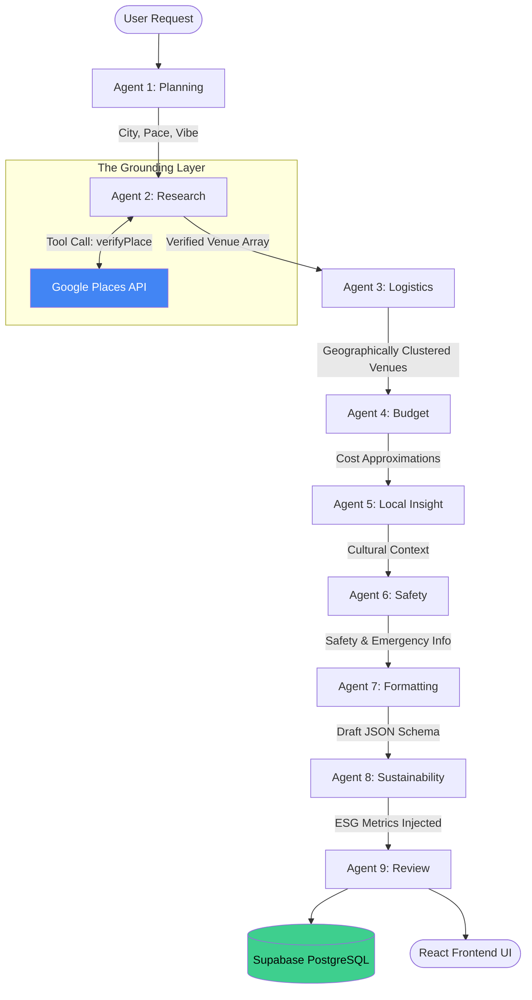

<div class="cover-page">
    <h1>Architecting an Agentic Travel Platform</h1>
    <div class="subtitle">Multi-Agent Systems, API Grounding, and Serverless Infrastructure in Modern Web Applications</div>
    <br><br><br>
    <p><strong>Bachelor's Thesis</strong></p>
    <p>Degree Programme in Information Technology</p>
    <br><br>
    <p><strong>Author:</strong> Salman Ihsan</p>
    <p><strong>Date:</strong> May 2026</p>
</div>

# Chapter 1: Introduction to Agentic Travel Systems

## 1.1 The Evolution of Web Application Paradigms
The architecture of web applications has undergone several distinct paradigm shifts over the last two decades. In the early days of the Web (Web 1.0), applications were largely static document retrievers. The advent of Web 2.0 introduced dynamic, database-driven applications heavily reliant on the CRUD (Create, Read, Update, Delete) paradigm. In this era, the application served as a passive conduit; if a user wanted to plan a complex travel itinerary, they had to act as the central processor—manually querying flight aggregators, cross-referencing geographical distances on Google Maps, and storing data in disparate spreadsheets. The user was the integrator of information.

The recent explosion of Large Language Models (LLMs) promised to automate this synthesis, ushering in what many consider the next iteration of the web: the AI-native application. Early attempts at integrating LLMs into travel planning relied on "zero-shot" prompting, where an application would send a single, large request to a model (e.g., "Plan a 3-day trip to Tokyo"). However, these early generative AI planners suffered from a fundamental architectural flaw: they treated the LLM as an omniscient database rather than a reasoning engine. Because LLMs lack real-time "world state" awareness, they often hallucinate—recommending restaurants that closed years ago or proposing physically impossible transit routes.

The solution to bridging the gap between generative creativity and deterministic accuracy is the **Agentic Web Application**. An agentic system does not rely on a single, monolithic prompt. Instead, it utilizes the LLM as a central orchestrator capable of utilizing external tools, calling deterministic APIs, and executing a multi-step workflow.

## 1.2 Problem Statement and Thesis Objective
Building an autonomous system capable of replacing a human travel agent presents significant software engineering challenges. The system must possess the creativity to design an engaging vacation while simultaneously adhering to strict logistical constraints, real-world data, and limited computational budgets.

This thesis details the architectural design, engineering principles, and deployment strategies behind a custom-built, multi-agent travel platform. The core objective of this research is to demonstrate how a complex, highly subjective task (generating a multi-day travel itinerary) can be reliably automated and scaled by decomposing it into a highly decoupled, 9-agent pipeline.

### Scope of the Study
To maintain rigorous focus on software systems engineering, this thesis strictly bounds its scope to the **Itinerary Generation Engine** and its subsequent **Data Utility**. 
Specifically, the thesis covers:
1.  **Multi-Agent System Architecture:** A detailed analysis of how 9 specialized AI agents are orchestrated, including their specific roles, prompt engineering, and inter-agent state management.
2.  **API Grounding and Tool Use:** How the system integrates with the Google Places API to anchor the LLM's outputs to verified geospatial and operational data.
3.  **Serverless Infrastructure & Cost Optimization:** An exploration of deploying heavy AI workloads on Vercel Edge Functions, including streaming strategies, dynamic model routing (Gemini 2.5 Flash vs. Pro), and strict API payload minimization.
4.  **Database Architecture and Data Utility:** How the generated itineraries are stored in a PostgreSQL database (Supabase) to enable caching, user analytics, and future post-generation automation features.

While the developed platform may eventually support real-time flight bookings or hotel reservations, those transactional features are explicitly excluded from the detailed architectural analysis in this document, which remains focused on the generation and processing of the itinerary data itself.

---

# Chapter 2: The Multi-Agent Architecture

## 2.1 Theoretical Framework: What is an Agentic Workflow?
In contemporary software engineering, interacting with an LLM typically involves a direct request-response cycle. An **Agentic Workflow** diverges from this by introducing autonomy, modularity, and environmental interaction. Drawing inspiration from frameworks like LangChain and AutoGen, an agent in this system is defined by three core capabilities:

1.  **Persona and Bounding:** The LLM is initialized with a strict system prompt that confines its operational scope (e.g., "You are exclusively a Logistics Coordinator. Do not suggest places; only route them.").
2.  **Tool Use (Function Calling):** The LLM is granted the ability to pause its text generation and output a structured command (usually JSON) intended to trigger external code—such as an API request or a database query.
3.  **Sequential State Passing:** The pipeline operates as a Directed Acyclic Graph (DAG). The output of one specialized agent becomes the highly structured, deterministic input for the next agent in the sequence.

## 2.2 Designing the 9-Agent Pipeline
To build a reliable travel itinerary, the monolithic generation task was decomposed into a 9-step sequential pipeline. This decoupled architecture is crucial; empirical testing showed that when a single LLM call is overwhelmed with conflicting instructions (e.g., trying to write creative descriptions while simultaneously ensuring geographical coordinates match and calculating carbon footprints), the model's performance degrades severely, leading to syntax errors and hallucination.



### Detailed Agent Roles and State Management

1.  **Agent 1: The Master Planner.** 
    *   *Function:* Ingests the unstructured user prompt (e.g., "3 days in Tokyo for a foodie, fast pace").
    *   *Output:* Calculates the exact number of meals and activities required, determines the target demographic, and passes a structured parameter object to the next agent.
2.  **Agent 2: The Researcher (The Grounding Engine).** 
    *   *Function:* The most critical agent in the pipeline. It takes the parameters from Agent 1 and autonomously formulates search queries. It executes external tools to ping the Google Maps API, retrieving actual `place_id`s, exact formatted addresses, and live ratings.
3.  **Agent 3: The Logistics Coordinator.** 
    *   *Function:* Inherits the verified list of places from Agent 2. Its sole job is to analyze the geographic coordinates (Lat/Lng) of the venues and cluster them into logical days and logical chronological orders (Morning, Afternoon, Evening) to minimize transit time.
4.  **Agent 4: The Budget Analyst.** 
    *   *Function:* Reviews the routed itinerary and appends estimated costs for meals, entry tickets, and transit, ensuring the total aligns with the user's declared budget tier.
5.  **Agent 5: The Local Guide.** 
    *   *Function:* Injects cultural context, specific dress codes, etiquette tips (e.g., "Do not tip in Japan"), and historical background for the chosen locations.
6.  **Agent 6: The Safety Advisor.** 
    *   *Function:* Evaluates the chosen neighborhoods. It provides localized emergency numbers, identifies common tourist scams in the area, and assesses the walkability and nighttime safety of the routed path.
7.  **Agent 7: The Formatter.** 
    *   *Function:* A highly rigid agent. It takes the accumulated data payload from Agents 1-6 and translates it into a strict, predefined TypeScript interface/JSON schema required by the React frontend components.
8.  **Agent 8: The Sustainability Assessor.** 
    *   *Function:* Analyzes the transit methods and venues in the formatted JSON to calculate an estimated carbon footprint and assigns an Environmental, Social, and Governance (ESG) score.
9.  **Agent 9: The Final Reviewer.** 
    *   *Function:* Acts as the ultimate quality assurance gate. It performs a final pass to validate that the JSON is syntactically perfect, that no unverified addresses slipped through, and that the final output aligns perfectly with the user's original request.

## 2.3 The Architectural Advantages of Decoupling
By splitting the generation process across 9 specialized agents, the system achieves the software engineering ideals of **High Cohesion and Low Coupling**. 

If the Google Maps API changes its payload structure or deprecates an endpoint, only Agent 2 requires refactoring. If the React frontend developers require a new JSON key to render a specific UI component, only Agent 7 needs its prompt updated. This separation of concerns prevents brittle code, allows for easier unit testing of individual agent prompts, and makes the system inherently scalable.

---

# Chapter 3: API Integration and Verified Data

## 3.1 Overcoming the Limits of Parametric Memory
To understand the necessity of the grounding layer, one must understand how LLMs store information. An LLM's knowledge is encoded within its neural network weights—this is known as *parametric memory*. While vast, parametric memory is static (frozen at the time of training) and probabilistic. When a user asks an LLM for a restaurant recommendation, the LLM is calculating the statistical probability of the next word based on its training data; it is not querying a live database.

In the context of travel planning, parametric memory is fatally insufficient. A museum might be world-famous in the training data, but closed for renovations in reality. Relying on parametric memory results in confident but factually incorrect outputs.

## 3.2 "API-Augmented Generation" via Google Places
To solve this, the architecture implements what can be described as API-Augmented Generation (a specialized form of Retrieval-Augmented Generation, or RAG). Grounding refers to the practice of forcing the LLM to base its generations on deterministic data injected into its context window at runtime.

Agent 2 (The Researcher) is responsible for this critical grounding phase. It is granted access to a `verifyPlace` tool, a custom-built TypeScript function acting as a secure wrapper around the Google Places API (New).

When Agent 2 determines that it wants to recommend the "Eiffel Tower", it does not simply generate narrative text about it. Instead, it pauses its generation and executes the tool with a JSON payload:
`verifyPlace({ query: "Eiffel Tower", location: "Paris, France" })`

### The Deterministic Search Workflow
1.  **Tool Execution:** The LLM outputs the tool call. The orchestration framework intercepts this and suspends the LLM.
2.  **API Request:** The Next.js backend makes a secure, authenticated HTTPS request to the endpoint `https://places.googleapis.com/v1/places:searchText`.
3.  **Data Extraction:** The Google API returns deterministic, live data about the venue from Google's proprietary database.
4.  **Context Injection:** The backend parses the API response, formats it, and feeds the verified data back into the LLM's context, instructing the LLM to resume generation based *only* on the injected facts.

## 3.3 Structuring and Sanitizing the Verified Payload
The raw JSON payload returned by the Google Places API is exceptionally dense, often containing hundreds of lines of data including HTML attributions, user-uploaded photo URIs, and deeply nested review strings. Passing this raw payload directly into the LLM's context window would consume massive amounts of tokens, increasing latency and skyrocketing API costs.

To maintain system efficiency, the application employs a strict sanitization layer that maps the Google API response to a minimal, highly optimized interface:

```typescript
interface VerifiedPlace {
  place_id: string;
  name: string;
  formattedAddress: string;
  rating: number;
  userRatingCount: number;
  googleMapsUri: string;
  primaryTypeDisplayName: string;
  location: {
    latitude: number;
    longitude: number;
  };
}
```

This sanitized, structured data object is the only information passed down the pipeline to Agents 3 through 9. Because Agent 2 verified the data against the authoritative Google Maps database, Agent 7 (The Formatter) is strictly instructed via system prompt to **only use the `formattedAddress` provided in the payload**. 

This architectural decision entirely prevents the LLM from hallucinating fake street names or non-existent businesses. By the time the itinerary reaches the user, it is no longer a creative fiction written by an AI; it is a highly structured data view populated by verified API endpoints.
