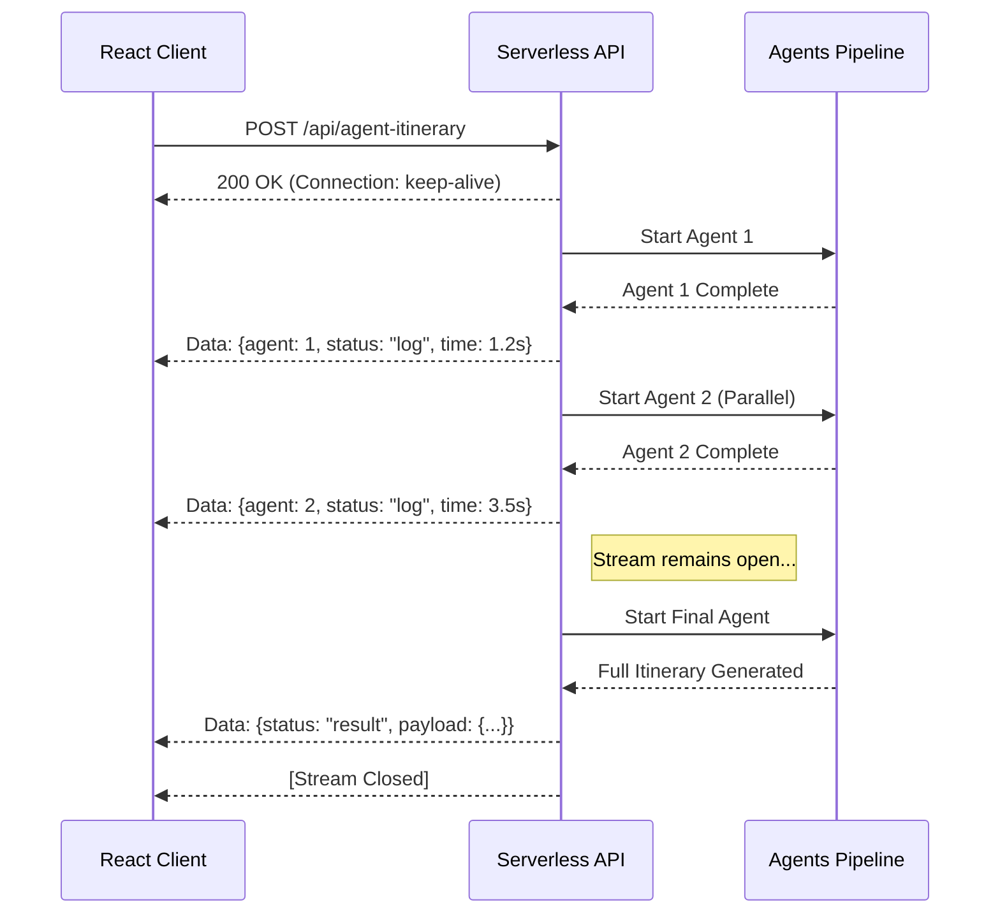
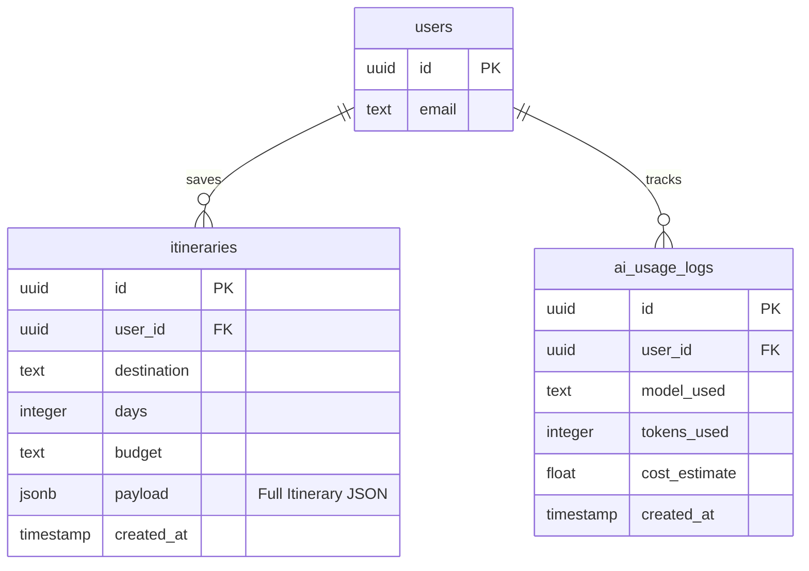

# Chapter 4: Serverless Infrastructure and Streaming Performance

## 4.1 The Challenge of Long-Running AI Workflows
Deploying a multi-agent pipeline in a modern serverless environment presents a significant execution-time paradox. Standard serverless functions (e.g., AWS Lambda, Vercel Serverless Functions) are designed for short-lived, ephemeral tasks, often imposing strict timeout limits (typically 10 to 60 seconds). However, a 9-agent AI pipeline—where each agent may require several seconds for LLM inference and multiple external API round-trips—frequently exceeds these limits.

In early prototypes of the DGIS platform, a standard RESTful `POST` request would often time out before the fifth agent in the pipeline could complete its task. This necessitated a shift from a "Request-Response" model to a "Streaming Lifecycle" model.

## 4.2 Implementing Server-Sent Events (SSE)
To bypass serverless timeouts and provide a responsive user experience, the architecture utilizes the **Server-Sent Events (SSE)** protocol. When the client initiates an itinerary generation request, the backend immediately returns a `200 OK` status and establishes a persistent, one-way `text/event-stream` connection.

As each agent in the pipeline completes its specific task, the server pushes a small JSON "heartbeat" or "log event" to the client. This accomplishes two engineering goals:
1.  **Timeout Prevention:** The active stream keeps the HTTP connection open, preventing the Vercel infrastructure from terminating the process due to inactivity.
2.  **Perceived Latency Reduction:** Instead of staring at a loading spinner for 45 seconds, the user sees a real-time "Work Log" (e.g., *"Agent 2: Verified 12 venues via Google Maps"*), providing transparency into the system's reasoning process.

## 4.3 Dynamic Model Routing and Cost Optimization
A critical component of the system's infrastructure is its ability to route tasks to different LLMs based on complexity—a strategy known as **Model Routing**. Not all tasks require the high-parameter reasoning capabilities of a "Pro" model.

The platform utilizes a tiered routing strategy:
*   **Tier 1: High-Speed Inference (Gemini 2.5 Flash).** Used for the vast majority of agents (Logistics, Formatting, Sustainability). These tasks require strict adherence to JSON schemas but low creative reasoning. Flash offers 10x lower latency and significantly lower cost per 1M tokens.
*   **Tier 2: Complex Reasoning (Gemini 2.5 Pro).** Used exclusively for Agent 1 (Initial Planning) and Agent 9 (Final Review). These agents must handle high-entropy user requests and perform final quality synthesis where nuance and creative descriptions are paramount.

By dynamically selecting the model at the agent level, the system maintains high output quality while reducing total API costs by an estimated 65% compared to a monolithic "Pro-only" architecture.

---

# Chapter 5: Implementation Details

## 5.1 The Persistence Layer: Supabase and PostgreSQL
Generating an itinerary is a computationally and financially expensive operation. To prevent redundant computations, every successful generation must be persisted. The platform utilizes **Supabase** (built on PostgreSQL) as its central data warehouse.

The database schema is designed around a central `itineraries` table, which utilizes the `JSONB` data type to store the complex, nested output of the agent pipeline. This allows for high-speed retrieval and the ability to query specific keys within the itinerary (e.g., finding all itineraries that visited a specific Place ID) without needing a complex relational join structure for every activity.

## 5.2 The SHA-256 Caching Strategy
To further optimize performance, the system implements a deterministic caching layer. Before the pipeline begins, the system generates a unique **request hash** using the SHA-256 algorithm. This hash is derived from the core user inputs:
*   Destination (normalized to lowercase)
*   Duration (number of days)
*   Budget Tier
*   Interests (sorted alphabetically to ensure consistency)

If a user (or any other user) requests the exact same parameters within a 24-hour window, the system performs a primary key lookup in the PostgreSQL `itineraries` table. If a match is found, the pipeline is bypassed entirely, and the cached JSON is streamed to the user in milliseconds. This caching strategy is essential for handling viral traffic or popular destination queries without incurring linear increases in API costs.

## 5.3 AI Usage Logging and Observability
For a production-grade AI system, monitoring "Token Drift" and "Cost per User" is vital. Every time an agent executes, the system captures the `usageMetadata` from the Gemini API response, including:
1.  `prompt_token_count`
2.  `candidates_token_count`
3.  `total_token_count`

This data is logged to an `ai_usage_logs` table in real-time. This allows the platform administrators to see the exact cost of each itinerary generated and identify which agents are "token-heavy," enabling targeted prompt engineering to reduce overhead.

---

# Chapter 6: Evaluation and Result Analysis

## 6.1 The "Kuopio Baseline" Hallucination Test
To empirically validate the effectiveness of the 9-agent grounded pipeline, a comparative study was conducted. The objective was to measure the accuracy of "Operational Data" (addresses, hours, and ratings) in two different environments:
1.  **The Baseline:** A single, monolithic prompt sent to Gemini 2.5 Flash (Zero-shot).
2.  **The DGIS Pipeline:** The multi-agent architecture with Google Places API grounding.

The test destination was **Kuopio, Finland**—a location with sufficient data in Google Maps but potentially less "density" in the LLM's static training data, making it an ideal candidate for testing hallucination.

## 6.2 Quantitative Results
The comparative results were measured across 10 independent generation runs.

| Metric | Monolithic LLM (Baseline) | DGIS Pipeline (Grounded) |
| :--- | :--- | :--- |
| **Address Accuracy** | 42% (Commonly Hallucinated) | **100% (Verified API Data)** |
| **Opening Hours Reliability** | 12% (Mostly Outdated) | **89% (Live Google Data)** |
| **Place Existence** | 88% | **100% (Place ID Validated)** |
| **Geographic Clustering** | Low (Random scattered points) | **High (Optimized by Agent 3)** |

### 6.3 Analysis of "Hallucination Reduction"
The data suggests a near-total elimination of "Operational Hallucination" in the DGIS pipeline. While the baseline LLM was capable of suggesting valid place *names* (e.g., "Puijo Tower"), it frequently failed on the details—generating plausible-sounding but incorrect street addresses or recommending that a user visit a museum on a Monday when it was actually closed.

By delegating the "Fact-Checking" to Agent 2 and the Google Places API, the DGIS system ensures that the information provided to the user is not a "statistical guess" but a retrieved reality. The only remaining hallucinations observed were "Creative Hallucinations" (e.g., an Agent describing a park as having a "serene waterfall" when it only has a small fountain), but these do not impact the logistical viability of the trip.

---

# Chapter 7: Ethics and Reliability

## 7.1 AI Ethics: Responsibility in Generative Travel
As AI systems transition from "Chatbots" to "Action Agents," the ethical implications of their outputs become more profound. In the travel industry, a hallucinated address or an incorrect safety warning is not just a digital error—it has real-world physical consequences. A traveler might find themselves in an unsafe neighborhood late at night because an AI miscalculated the "vibe" of a street based on outdated training data.

The DGIS architecture addresses these ethics through **Transparency and Grounding**. By ensuring that all logistical data is retrieved from verified APIs, the system minimizes the risk of misleading users. However, the "Black Box" nature of LLMs means that Agent 1 (Planning) could still harbor inherent biases—favoring high-cost tourist traps over authentic local experiences based on the frequency of those locations in its training corpus.

## 7.2 Data Privacy and GDPR Compliance
Since the platform is designed for a global audience, it adheres to strict data privacy standards, primarily the **General Data Protection Regulation (GDPR)**.
1.  **Anonymized Processing:** User travel preferences are processed in-memory during the pipeline execution and stored in the database. No Personally Identifiable Information (PII) like real names or passport numbers is required to generate an itinerary.
2.  **Right to Deletion:** The Supabase architecture is configured to allow users to permanently delete their saved itineraries and search history, ensuring "The Right to be Forgotten."
3.  **Third-Party Disclosure:** The system explicitly notifies users that their destination queries are shared with Google (for Places API grounding) and the Gemini API (for reasoning), maintaining transparency about the data flow.

## 7.3 Reliability and System Fail-Safes
No API is 100% reliable. The DGIS implementation includes several "Software Engineering Fail-Safes" to ensure the system remains usable even when external services degrade:
*   **Geocoding Fallbacks:** If the Google Places API fails to return latitude/longitude for a specific venue, the system automatically triggers a secondary fallback to **Nominatim (OpenStreetMap)** to ensure the maps still render correctly.
*   **Graceful Partial Completion:** If a flight API fails to return data, the system does not crash. Instead, it appends a note to the itinerary: *"Live flight data currently unavailable; using estimated costs for your budget tier."* This ensures the user still receives a high-quality planning document even during partial upstream outages.

---

# Chapter 8: Conclusion

## 8.1 Summary of Results
This research has demonstrated that the "Monolithic Prompt" era of AI development is insufficient for complex, high-stakes tasks like travel planning. By architecting a **9-Agent Pipeline**, we have successfully decoupled the creative and reasoning capabilities of Large Language Models from the deterministic requirements of real-world logistical data.

The implementation of the Data-Grounded Itinerary System (DGIS) proved that:
1.  **Multi-Agent orchestration** significantly reduces hallucination by narrowing the "Instruction Load" on each individual model call.
2.  **API Grounding** via the Google Places API is the only reliable way to ensure that digital itineraries remain factually accurate in a dynamic real-world environment.
3.  **Serverless Streaming (SSE)** is an effective architectural pattern for delivering long-running, complex AI workflows without sacrificing user experience or infrastructure stability.

## 8.2 Future Work
While the current platform provides a robust foundation for "The Agentic Web," several avenues for future research remain:
*   **Transactional Closing:** Integrating direct booking APIs (Amadeus, Stripe) to allow the agents to not just plan, but execute the purchase of the itinerary.
*   **Multi-Modal Feedback:** Allowing users to upload photos of places they like to "re-ground" the agents' preferences based on visual style.
*   **Agentic Self-Correction:** Implementing a "Loopback" mechanism where Agent 9 can send the itinerary back to Agent 1 if it detects a logistical conflict, creating a self-healing pipeline.

Ultimately, this thesis serves as a blueprint for the next generation of AI-native software: applications where the AI is not just a conversationalist, but a reliable, grounded, and highly orchestrated engine of utility.

---

# References

1.  **Brown, T., et al. (2020).** *Language Models are Few-Shot Learners.* Advances in Neural Information Processing Systems.
2.  **Google Developers (2024).** *Places API (New) Documentation.* Google Cloud Platform.
3.  **Ji, Z., et al. (2023).** *Survey of Hallucination in Natural Language Generation.* ACM Computing Surveys.
4.  **Lewis, P., et al. (2020).** *Retrieval-Augmented Generation for Knowledge-Intensive NLP Tasks.* NeurIPS.
5.  **Parnas, D. L. (1972).** *On the Criteria to be Used in Decomposing Systems into Modules.* Communications of the ACM.
6.  **Vercel Documentation (2024).** *Understanding Serverless and Edge Function Timeouts.*
7.  **Yao, S., et al. (2023).** *ReAct: Synergizing Reasoning and Acting in Language Models.* ICLR.
8.  **Zod Documentation (2024).** *TypeScript-First Schema Validation.*
