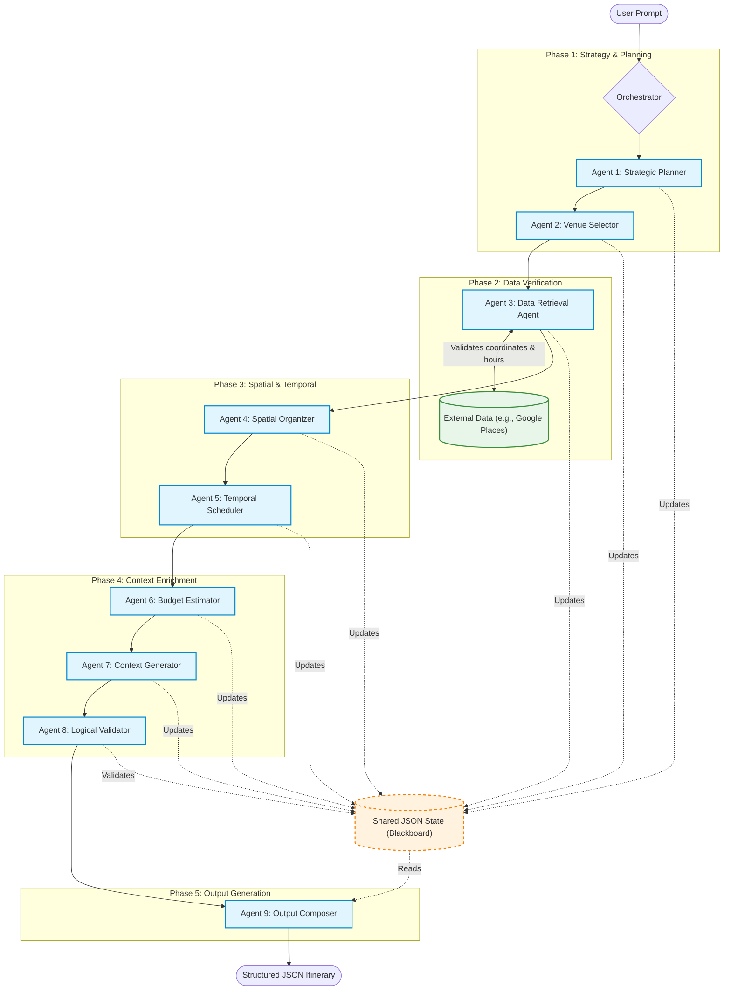
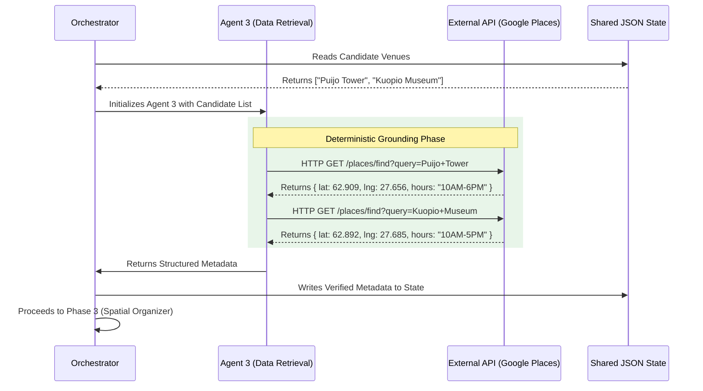
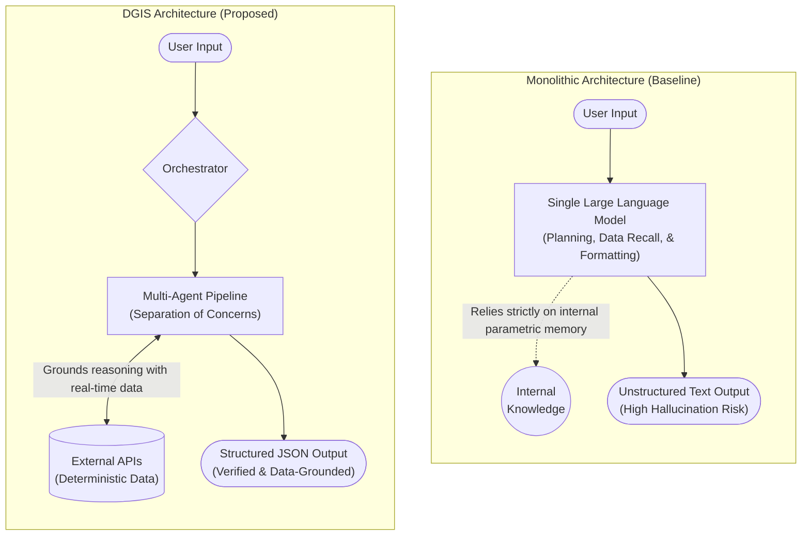

# Abstract

The increasing adoption of Large Language Models (LLMs) in software applications has highlighted both their capabilities and limitations, particularly in tasks that require structured reasoning and integration with real-world data. Traditional implementations are often based on a monolithic architecture, where a single model is responsible for generating complete, end-to-end outputs. While this approach is generally effective for natural language generation tasks, it may introduce challenges related to consistency, integration of externally verified data, and structured output usability in practical applications.

This thesis investigates an alternative architectural approach based on Agentic AI and Multi-Agent Systems (MAS). It introduces the Data-Grounded Itinerary System (DGIS), a pipeline-based architecture that decomposes the travel itinerary generation process into a sequence of specialized agents. Each agent is responsible for a specific task, including strategic planning, data retrieval, spatial organization, temporal scheduling, and final output generation. The system integrates generative language models with deterministic external data sources, enabling structured processing and improved control over intermediate representations.

A comparative evaluation was conducted between a monolithic LLM-based system and the proposed multi-agent architecture under identical input conditions. The evaluation focused on geospatial consistency, temporal alignment, data completeness, and structural validity of generated itineraries. The results of this study suggest that the multi-agent approach is associated with improved consistency and reliability through the integration of verified data and structured workflow design.

The findings indicate that the effectiveness of AI-driven applications is strongly influenced by system architecture. By applying software engineering principles such as separation of concerns, modularity, and structured data management, the proposed approach illustrates how LLMs can be integrated into more controlled and maintainable systems. While the implementation is focused on travel planning, the architectural concepts discussed in this thesis may be applicable to other domains requiring coordinated reasoning and data integration.

---

# Chapter 1: Introduction

### 1.1 Background
The integration of artificial intelligence into modern software systems has accelerated rapidly with the emergence and commercialization of Large Language Models (LLMs). These models, built upon advanced transformer architectures, possess unprecedented capabilities in generating coherent, contextually relevant, and semantically rich text [Citation]. As a result, LLMs are increasingly transitioning from experimental conversational interfaces into core processing components within complex software engineering workflows.

Early implementations of LLM-based applications typically followed a monolithic interaction paradigm. In this architecture, a single model receives a user prompt, processes the contextual intent, and generates a complete, end-to-end response in a single execution pass. While this approach is highly effective for general-purpose natural language generation tasks—such as summarization, translation, or creative writing—it presents significant architectural limitations when applied to domains requiring structured reasoning, real-world data integration, and strict operational constraints.

Travel planning represents one such complex domain. Constructing a viable and practical travel itinerary requires the orchestration of multiple distinct factors. It demands location discovery, spatial reasoning to ensure geographic proximity, and temporal scheduling constrained by the strict operating hours of real-world venues. Furthermore, modern digital applications require this information to be presented as structured data (e.g., JSON) rather than unstructured text. 

When these distinct responsibilities are handled within a single, black-box model interaction, the system lacks a clear separation of functional responsibilities. Because LLMs are fundamentally probabilistic engines rather than deterministic databases, they often infer or "hallucinate" real-world data when direct, real-time verification is absent [Citation]. This highlights a critical architectural limitation: monolithic LLM systems struggle to safely and consistently manage data-dependent applications.

To address these systemic challenges, recent research and industry practice have shifted toward Agentic AI and Multi-Agent Systems (MAS) [Citation]. In this paradigm, complex, multi-step workflows are decomposed into smaller, specialized components. Each "agent" operates within a strictly defined scope, often equipped with specific tools or data access rights. This approach deeply aligns with foundational software engineering principles, particularly the *separation of concerns*, providing a pathway to improve system maintainability, modularity, and control. By combining the generative flexibility of LLMs with structured pipelines and deterministic data sources (such as external APIs), it becomes possible to engineer systems that are both highly capable and strictly reliable.

### 1.2 Problem Statement
Despite the widespread availability and adoption of powerful LLMs, deploying them reliably in production systems remains a formidable challenge, particularly in applications requiring precise, verifiable, and structured data. The primary obstacle appears to be related to system architecture rather than the linguistic capabilities of the models themselves.

In monolithic LLM designs, a single model is burdened with competing responsibilities: it must interpret user intent, generate creative content, implicitly retrieve factual data from its parametric memory, and format the output according to strict schemas. This consolidation of responsibilities severely reduces system modularity and makes the underlying behavior difficult to trace, control, and evaluate.

From a software engineering perspective, this architectural bottleneck introduces several specific challenges:
*   **Limited Deterministic Validation:** A single-pass generative process cannot easily halt generation to verify a specific fact (e.g., verifying if a museum is open on a Monday) before continuing its output.
*   **Propagation of Inconsistencies:** If an LLM hallucinates a location name early in its generation, it will logically (but incorrectly) base the rest of the itinerary's temporal and spatial scheduling on that initial error.
*   **Reduced Transparency:** The lack of observable intermediate states makes it nearly impossible for developers to debug where or why the reasoning process failed.

These challenges are critically relevant in travel planning applications, where the correctness of spatial and temporal data dictates the practical usability of the software. Therefore, the problem addressed in this thesis is the urgent need for a structured architectural approach that mitigates LLM hallucinations and improves data reliability by separating generative reasoning from deterministic data processing.

### 1.3 Aim of the Thesis
The primary aim of this thesis is to design, implement, and evaluate a multi-agent software architecture tailored to improve the structural consistency and factual reliability of AI-generated travel itineraries.

To achieve this, the thesis introduces the **Data-Grounded Itinerary System (DGIS)**. The DGIS architecture decomposes the traditional, single-prompt itinerary generation process into a sequential pipeline of highly specialized agents. Each agent performs an isolated function—such as strategic planning, external data retrieval, spatial routing, or output formatting—and communicates through a structured, shared state representation (a blackboard pattern).

Rather than relying on a single model's internal memory to execute the entire task, the DGIS integrates generative LLM components with deterministic external data APIs. This design aims to eliminate ambiguity in task execution and strictly enforce data consistency.

A secondary aim of this research is to demonstrate that by utilizing a multi-agent pipeline, AI outputs can be treated reliably as a structured data product (e.g., database-ready JSON). This approach is intended to significantly improve traceability, debugging capabilities, and system reusability compared to traditional unstructured text outputs.

### 1.4 Scope of the Study
This study focuses strictly on the architectural design and software engineering evaluation of a multi-agent AI system within the context of automated travel planning.

The scope of the research includes:
*   The architectural design of a multi-agent pipeline utilizing the principle of separation of concerns.
*   The integration of generative LLMs with deterministic external APIs (e.g., Google Places API) for real-time data retrieval and grounding.
*   The implementation of structured state management for secure and traceable inter-agent communication.
*   A qualitative comparative evaluation of the system's outputs against a standard monolithic LLM baseline.

The evaluation utilizes a controlled scenario based on the city of Kuopio, Finland, providing a realistic, constrained environment for testing spatial and temporal workflows.

The study explicitly excludes:
*   The training, fine-tuning, or development of new foundational machine learning models.
*   Large-scale quantitative benchmarking or latency testing across multiple global datasets.
*   Detailed user interface (UI) or user experience (UX) design evaluations.
*   Commercial deployment, scalability testing, or cost-optimization analysis for enterprise production.

### 1.5 Research Objectives
To fulfill the overarching aims, this thesis is guided by the following specific research objectives:
1.  **Architectural Design:** To design a multi-agent pipeline that cleanly separates strategic planning, deterministic data retrieval, and output generation into distinct, observable components.
2.  **Implementation Feasibility:** To demonstrate and evaluate whether such a highly structured system can be effectively implemented using currently available LLM frameworks and modern API infrastructure.
3.  **Comparative Evaluation:** To qualitatively compare the outputs of the proposed DGIS architecture against a traditional monolithic baseline under identical input conditions.
4.  **Data Consistency Analysis:** To analyze the extent to which the proposed multi-agent architecture mitigates hallucination and improves consistency across spatial, temporal, and structural data dimensions.

### 1.6 Significance of the Study
This research highlights a crucial paradigm shift in AI application development: emphasizing the importance of system architecture over pure model capability. While the AI industry frequently focuses on scaling model parameters to improve intelligence, this study suggests that output reliability, factual accuracy, and system maintainability depend just as heavily on how models are integrated into broader software environments.

By applying established software engineering principles—such as modularity and abstraction—to modern AI workflows, the proposed DGIS architecture provides a structured framework for building systems that balance generative flexibility with enterprise-grade reliability. The findings presented in this thesis are relevant not only to automated travel planning but to any domain (such as healthcare, finance, or logistics) where the integration of generative AI with strict, deterministic data is required.

---

# Chapter 2: Literature Review

### 2.1 Introduction
This chapter reviews the existing body of research and current architectural approaches regarding the integration of Large Language Models (LLMs) into production software systems. The discussion traces the evolution of these systems, beginning with traditional monolithic LLM architectures and their inherent limitations. It then explores methods developed to mitigate these limitations, specifically focusing on data grounding techniques. Finally, the chapter examines the emergence of Multi-Agent Systems (MAS) and Agentic AI workflows, highlighting how the application of traditional software engineering principles provides the theoretical and practical foundation for the proposed Data-Grounded Itinerary System (DGIS).

### 2.2 Monolithic LLM Architectures
The earliest and most prevalent method of interacting with LLMs follows a single-pass, monolithic interaction model. In this architecture, a user prompt is delivered to a single LLM instance, which processes the input entirely within its context window and generates a complete response [Citation]. This design—often relying on zero-shot or few-shot prompting techniques—is highly accessible, relatively simple to implement, and has demonstrated remarkable proficiency in general natural language generation tasks.

However, both practical industry applications and recent academic studies suggest that this monolithic approach faces severe limitations when applied to scenarios requiring highly structured outputs and the integration of real-world, dynamic data [Citation]. Because LLMs generate text based on probabilistic statistical patterns learned during their pre-training phase, they possess an inherent "parametric memory." While this memory contains vast amounts of general knowledge, it is static, finite, and lacks the ability to inherently verify the factual correctness or current validity of the information it generates.

In data-sensitive domains such as automated travel planning, relying solely on parametric memory frequently results in "hallucinations"—instances where the model generates plausible but factually incorrect information [Citation]. For example, a monolithic system might successfully generate a geographically logical sequence of attractions, but hallucinate the operating hours or exact addresses of those venues. Furthermore, requiring a single model to simultaneously perform intent recognition, spatial reasoning, factual recall, and strict schema formatting (e.g., generating syntactically valid JSON) significantly increases the cognitive load on the model, leading to degraded performance across all tasks [Citation]. These limitations are now widely interpreted in the literature not merely as deficiencies in the model's linguistic capability, but as fundamental architectural constraints.

### 2.3 Grounding Through External Data Sources
To mitigate the risks of hallucination and improve factual reliability, the AI research community has developed approaches to integrate external data sources directly into the generation process. This concept is commonly referred to as "grounding," where the model's generated content is explicitly supported, constrained, or verified by external, deterministic information.

One of the most widely adopted grounding techniques is Retrieval-Augmented Generation (RAG) [Citation]. In a standard RAG architecture, relevant documents or text snippets are retrieved from a vector database and injected into the LLM's context window prior to generation. While RAG significantly improves factual alignment in static knowledge domains (such as querying a company's internal documentation), its effectiveness is limited in highly dynamic environments. Travel planning requires real-time data access—such as checking if a specific museum is closed on a public holiday today—which a pre-indexed RAG database cannot reliably provide.

To achieve real-time grounding, API-based integration (often referred to as "Tool Use" or "Function Calling") has become increasingly prominent [Citation]. This allows the LLM to pause generation, execute an external API call, and use the returned deterministic data to inform its final output. While API-based grounding provides direct access to up-to-date information, implementing it within a monolithic architecture presents new challenges. When a single model is made responsible for reasoning, planning, executing multiple API calls, parsing the results, and generating the final output, the system's operational complexity scales rapidly [Citation]. Context windows become bloated with API responses, and developers lose granular control and observability over the intermediate reasoning steps.

### 2.4 Multi-Agent Systems and Agentic AI
To address the bottleneck of monolithic API orchestration, recent research has pivoted toward Multi-Agent Systems (MAS). MAS is a well-established concept in computer science where complex, distributed problems are solved by decomposing them into smaller, manageable components handled by independent "agents" [Citation]. 

The advent of highly capable LLMs has revitalized this field, giving rise to "Agentic AI." In this modern paradigm, LLMs are embedded within individual, narrowly scoped agents [Citation]. Rather than functioning as a single, general-purpose oracle, the LLM is constrained to specific roles defined by system prompts—for example, one agent acts strictly as a "Spatial Organizer," while another acts solely as a "Data Retrieval Specialist." System-level behavior and complex problem-solving emerge from the structured interaction and collaboration of these specialized agents.

This multi-agent design directly addresses the cognitive overload seen in monolithic systems. By narrowing the scope of an individual LLM call, the model's reliability and instruction-following capability increase significantly [Citation]. Different aspects of a complex task—such as strategic planning, real-world data retrieval, and output formatting—can be handled independently, allowing for intermediate validation checks between stages.

### 2.5 Software Engineering Principles in AI Systems
The transition from monolithic prompts to multi-agent pipelines represents a broader trend: the formal application of traditional software engineering principles to AI system design [Citation]. As AI systems move from prototypes to production environments, principles such as modularity, abstraction, and the separation of concerns are becoming critical.

The principle of the "separation of concerns," famously articulated by Dijkstra [Citation], dictates that a program should be divided into distinct features that overlap in functionality as little as possible. In LLM-based systems, applying this principle introduces clear system boundaries. By defining explicit interfaces between agents—such as requiring agents to communicate exclusively via validated JSON schemas—developers can enforce structured data flow. 

Furthermore, MAS architectures frequently employ structured state management, often resembling the "Blackboard architectural pattern" [Citation]. In this pattern, agents do not communicate directly with one another; instead, they read from and write to a shared, structured state object. This approach profoundly improves system observability, reduces execution ambiguity, and allows developers to trace exactly how and when data is transformed at every stage of the pipeline.

### 2.6 Summary
The reviewed literature indicates a necessary and gradual shift in AI application design, moving away from simple, monolithic LLM architectures toward more modular, engineered, and structured system designs. While grounding techniques like RAG and API integration are essential for improving data reliability, their ultimate effectiveness depends heavily on the architecture in which they are deployed. 

Multi-agent architectures represent a highly promising direction. By combining the generative reasoning capabilities of LLMs with the deterministic data processing of traditional software within a controlled, observable workflow, MAS provides a robust solution to the limitations of single-pass models. This synthesis of Agentic AI and established software engineering principles forms the conceptual and theoretical basis for the Data-Grounded Itinerary System (DGIS) architecture proposed in the subsequent chapters of this thesis.

---

# Chapter 3: System Architecture

### 3.1 Introduction
The reliability, predictability, and overall behavior of AI-based applications are significantly influenced by their underlying architectural design. While Large Language Models (LLMs) provide robust capabilities in natural language understanding and generation, their effectiveness in structured, data-dependent applications relies heavily on how they are integrated into a larger software ecosystem. Relying solely on prompt engineering within a monolithic model is often insufficient for complex workflows.

This chapter presents the design of the **Data-Grounded Itinerary System (DGIS)**, a multi-agent software architecture developed to explore a robust alternative to monolithic LLM-based workflows. The system decomposes the inherently complex process of travel itinerary generation into multiple, highly specialized components, each responsible for a specific cognitive or deterministic function within a strictly controlled pipeline. The primary objective of this architectural design is to improve structural clarity, mitigate generative hallucinations, and enable the seamless integration of deterministic external data sources at clearly defined stages of processing.

### 3.2 Architectural Design Principles
The DGIS architecture is not based merely on chaining prompts together; rather, it is founded upon several established software engineering principles adapted for Agentic AI.

#### 3.2.1 Separation of Concerns
The core tenet of the DGIS architecture is the separation of concerns. The system divides the overarching goal of itinerary generation into distinct, isolated stages. Each stage is responsible for a single, specific function—such as strategic planning, external data retrieval, spatial routing, or output formatting. By enforcing strict boundaries, this separation drastically reduces functional overlap between components and prevents the cognitive overload that occurs when a single LLM attempts to plan, verify, and format simultaneously.

#### 3.2.2 Modularity and Composability
Each agent within the DGIS pipeline is designed as an independent module with a clearly defined input-output interface. Agents are agnostic to the internal workings of other agents; they simply expect a specific structured input and guarantee a specific structured output. This modular structure allows individual components to be developed, optimized, tested, and even swapped out (e.g., upgrading a specific agent to a newer LLM model) independently. This design significantly improves system maintainability and supports the reuse of specific agents across different workflows.

#### 3.2.3 Deterministic Data Integration
A critical design consideration of the DGIS is the mandated use of deterministic external data sources at specific stages of the pipeline. Instead of relying solely on the generative model to "remember" or infer venue details, the system is architected to pause generative reasoning and retrieve structured, verified data from external APIs (such as geographic coordinates and operating hours). By anchoring the generative process to real-world data, the system strictly limits the LLM's capacity to hallucinate critical travel constraints.

#### 3.2.4 Structured State Management
To facilitate communication between disparate agents without direct coupling, the system employs a structured, JSON-based state object. This design functions similarly to a "Blackboard architectural pattern," where a shared state evolves over time. Each agent reads the current state, performs its specific processing, and writes its structured output back to the shared state. This provides highly structured communication, unparalleled traceability of intermediate outputs, and clear diagnostic boundaries for debugging.

### 3.3 Multi-Agent Pipeline Overview
The DGIS architecture is conceptualized as a multi-stage, sequential pipeline comprising nine specialized agents organized into five logical phases of progressive refinement:

1.  **Phase 1: Strategy and Planning** – Establishing the high-level parameters and candidate locations.
2.  **Phase 2: Data Retrieval and Verification** – Anchoring candidates to real-world, deterministic data.
3.  **Phase 3: Spatial and Temporal Organization** – Routing and scheduling based on physical constraints.
4.  **Phase 4: Context Enrichment and Validation** – Adding descriptive value and verifying logical consistency.
5.  **Phase 5: Final Output Generation** – Formatting the validated state into user-facing deliverables.

Each phase performs a specific transformation on the shared JSON state object, progressively refining raw user intent into a highly structured, data-grounded itinerary.


*Figure 1: The architecture of the Data-Grounded Itinerary System (DGIS). The system processes user input through 9 specialized agents across 5 logical phases, utilizing a shared JSON state (blackboard pattern) and integrating deterministic external data via API.*

### 3.4 Agent Design

#### 3.4.1 Phase 1: Strategy and Planning
*   **Agent 1: Strategic Planner**
    The pipeline is initiated by the Strategic Planner. This agent analyzes the raw user input to define the overarching structure of the itinerary. It determines high-level constraints such as the total trip duration, target demographics, and the thematic distribution of activities (e.g., balancing historical sites with culinary experiences).
*   **Agent 2: Venue Selector**
    Operating on the strategy produced by Agent 1, the Venue Selector generates a preliminary, unverified list of potential venues. At this stage, the output is explicitly treated as an initial "candidate set." The LLM is permitted to brainstorm freely, as the subsequent stages are designed to filter out invalid suggestions.

#### 3.4.2 Phase 2: Data Verification
*   **Agent 3: Data Retrieval Agent**
    This agent serves as the critical bridge between generative reasoning and deterministic reality. It extracts the candidate venue names from the shared state and queries external APIs (e.g., Google Places) to retrieve structured metadata. This includes exact physical addresses, precise geographic coordinates, operating hours, and user ratings. Crucially, any venue generated by Agent 2 that cannot be definitively matched with external data sources is aggressively pruned from the state and excluded from further processing.

#### 3.4.3 Phase 3: Spatial and Temporal Organization
*   **Agent 4: Spatial Organizer**
    With a verified set of venues containing precise coordinates, the Spatial Organizer takes over. This agent organizes the venues based on geographic proximity. Its sole objective is to calculate optimal daily clusters, reducing unnecessary travel distance and ensuring a logical physical flow for the traveler.
*   **Agent 5: Temporal Scheduler**
    Operating on the spatially clustered venues, the Temporal Scheduler assigns strict time slots. Because Agent 3 provided deterministic operating hours, Agent 5 can confidently schedule activities without violating real-world constraints (e.g., preventing a museum visit on a day it is closed). It also accounts for estimated visit durations and transit times between the spatially organized points.

#### 3.4.4 Phase 4: Context Enrichment
*   **Agent 6: Budget Estimator**
    This agent analyzes the scheduled activities and applies heuristic estimations or retrieves pricing data to provide the user with approximate cost estimates for each activity and the trip as a whole.
*   **Agent 7: Context Generator**
    Once the hard constraints (time, location, cost) are locked in, the Context Generator focuses on narrative enrichment. It adds engaging, descriptive contextual information for each venue, enhancing the user experience without risking the alteration of the verified metadata.
*   **Agent 8: Logical Validator**
    Acting as a final internal auditor, the Logical Validator scans the enriched JSON state. It checks for overarching consistency across all components, identifying potential structural issues, overlapping schedules, or logical impossibilities before the data is finalized.

#### 3.4.5 Phase 5: Output Generation
*   **Agent 9: Output Composer**
    The final agent in the pipeline, the Output Composer, converts the highly structured, validated JSON state object into a clean, human-readable itinerary format. By design, this agent relies exclusively on the previously verified and locked data, ensuring no new hallucinations are introduced at the formatting stage.

### 3.5 State Management
The operational success of the DGIS relies heavily on its JSON-based shared state. As the pipeline executes, the state evolves from a simple list of user preferences into a deeply nested, verified data structure. Each agent receives only the subset of data required for its specific task and appends its results back to the master object. 

This explicit state management supports deeply traceable data flow. If a scheduling error occurs, developers can inspect the JSON state exactly as it existed after Agent 4 and before Agent 5, making debugging exceptionally precise compared to diagnosing a monolithic LLM output.

```json
// Example: Phase 1 (Unverified)
{
  "venue": "Puijo Tower",
  "coordinates": null,
  "verified": false
}

// Example: Phase 5 (Fully Grounded)
{
  "venue": "Puijo Tower",
  "coordinates": { "lat": 62.909, "lng": 27.656 },
  "hours": "10:00 - 18:00",
  "verified": true
}
```
*Figure 4 (Placeholder Reference): Simplified representation of the shared JSON state evolution, demonstrating the transition from unverified generative output to fully grounded, deterministic metadata.*

### 3.6 Comparison with Monolithic Architecture
Monolithic systems process all the aforementioned tasks—planning, verifying, routing, scheduling, and writing—within a single, opaque model call. In stark contrast, the DGIS separates these tasks into nine distinct stages.

This separation radically improves the clarity of system behavior, allows independent control and optimization of individual processing steps, and makes the integration of external data explicit and verifiable. However, it must be acknowledged that this architecture introduces significant system complexity. It requires robust orchestration logic to manage the sequential execution, handles higher latency due to multiple network calls, and demands rigorous error handling between agent hand-offs.

### 3.7 Summary
This chapter detailed the DGIS architecture, a multi-agent system meticulously designed to structure itinerary generation into modular, observable stages. By adhering to established software engineering principles, the DGIS successfully integrates deterministic external data sources with generative LLM components, providing a robust architectural framework capable of mitigating the hallucination risks inherent in monolithic models.

---

# Chapter 4: Implementation and Infrastructure

### 4.1 Introduction
While Chapter 3 detailed the theoretical architectural design of the Data-Grounded Itinerary System (DGIS), this chapter focuses on its practical implementation. Transitioning a conceptual multi-agent design into a functional, production-ready application requires careful consideration of software infrastructure, data flow management, and API orchestration. The implementation strategy focuses on ensuring secure and structured communication between independent agents, seamless integration of external APIs, and the efficient execution of the multi-agent pipeline within a modern web infrastructure.

### 4.2 System Overview
To maintain a clear separation of concerns at the application level, the DGIS is implemented using a strict three-tier architecture:
1.  **User Interaction Layer:** The frontend client responsible for capturing user preferences, displaying loading states (streaming updates), and rendering the final interactive itinerary.
2.  **Orchestration Layer:** The central backend controller that manages the execution lifecycle of the pipeline, handling agent instantiation, state passing, and error recovery.
3.  **Processing Layer:** The decentralized collection of the 9 specialized agents (including both LLM integrations and deterministic API handlers) that perform the actual computational and generative work.

This layered separation allows clear distinction between user-facing functionality and complex backend logic, ensuring that the heavy computational workload of the MAS does not interfere with the client experience.

### 4.3 Technology Stack
The implementation utilizes a modern, JavaScript-based technology stack to ensure high performance and tight integration between the frontend and backend:
*   **Node.js / TypeScript:** Serves as the primary runtime for the orchestration layer. TypeScript is specifically utilized to enforce strict typing on the JSON state object as it passes between agents.
*   **LLM API Services:** Commercial Large Language Model endpoints (such as OpenAI or Google Gemini APIs) power the generative agents (e.g., the Strategic Planner and Context Generator).
*   **External Data APIs:** The Google Places API (or similar geospatial services) is integrated for deterministic data retrieval, providing verified addresses, coordinates, and operating hours.
*   **PostgreSQL:** A relational database used for the persistent storage of the final structured itineraries, enabling user accounts and historical data retrieval.
*   **Web Framework (e.g., Next.js):** Provides both the React-based User Interaction layer and the serverless API routes required to trigger the orchestration pipeline.

### 4.4 Pipeline Orchestration
The orchestration layer acts as the "conductor" of the DGIS. When a user request is received, the orchestrator initializes an empty JSON state object and begins executing agents in a strictly sequential manner. 

The execution flow follows the phases outlined in the architecture: User input is received $\rightarrow$ Strategy is generated $\rightarrow$ Venues are selected $\rightarrow$ Data is retrieved and verified $\rightarrow$ Spatial/Temporal scheduling occurs $\rightarrow$ Final Output is generated. 

Crucially, the orchestrator handles the "hand-off." After Agent 1 completes its task, the orchestrator takes Agent 1's output, validates it, appends it to the master state object, and passes the updated state as the input to Agent 2. This isolates the agents, ensuring they only interact with the orchestrator rather than directly with one another.

### 4.5 Structured LLM Interaction
For the multi-agent pipeline to function, it is imperative that the LLM-based agents return machine-readable data rather than conversational text. Each generative agent is strictly constrained to return structured JSON outputs.

This constraint is enforced through three mechanisms:
1.  **Strict Prompt Design:** System instructions explicitly demand JSON formatting and provide structural templates.
2.  **Structured Response Formatting:** Utilizing modern LLM features (such as "JSON Mode" or "Structured Outputs") at the API level to guarantee the schema of the response.
3.  **Intermediate Validation:** The orchestrator runs a schema validation check (e.g., using a library like Zod) on the LLM's output before appending it to the state. If the JSON is malformed, the orchestrator can request the agent to regenerate the output.

This rigorously reduces the ambiguity in inter-agent communication, preventing the pipeline from crashing due to unexpected text formatting.

### 4.6 External API Integration
The deterministic core of the DGIS lies in Agent 3 (the Data Retrieval Agent). This agent maps the generative venue suggestions to real-world entities. 

When calling external services like the Google Places API, the system is designed for efficiency. Only the strictly required fields are requested—such as location addresses, geographic coordinates (latitude/longitude), operating hours, and aggregate ratings. Requesting full data payloads for every venue would introduce severe network latency and unnecessary costs. Venues that return ambiguous or empty results from the API are programmatically pruned from the state, ensuring that downstream routing and scheduling agents only work with verified coordinates.


*Figure 3: Sequence diagram illustrating the deterministic grounding phase. The Orchestrator passes unverified candidate venues to Agent 3, which interfaces with external APIs to retrieve verified geospatial and temporal metadata before updating the shared state.*

### 4.7 Performance Considerations
Multi-agent systems are inherently more resource-intensive than monolithic models. To manage operational costs and execution speed, several performance strategies are implemented:
*   **Scoped State Passing:** Rather than passing the entire, ever-growing JSON state to every agent, the orchestrator strips the payload, sending only the relevant context required for that specific agent's task. This drastically reduces token usage and limits context-window bloat.
*   **Model Routing:** Not all tasks require the most advanced (and expensive) LLMs. Simpler tasks, such as the Logical Validator, can be routed to smaller, faster, and cheaper models, reserving high-parameter models for complex tasks like Strategic Planning.
*   **Caching:** External API responses are aggressively cached. If multiple users request itineraries for Kuopio, the system can retrieve the coordinates and hours for popular venues from a local cache rather than executing redundant, paid API calls.

### 4.8 Deployment Approach
The entire orchestration backend is deployed using a stateless, serverless execution model (e.g., Vercel Serverless Functions). Each user request triggers an independent, isolated execution of the pipeline.

This approach provides several operational benefits:
*   **Scalability:** The infrastructure scales automatically under variable user load without manual intervention.
*   **Reduced Management:** Serverless architecture eliminates the need to provision or maintain persistent backend servers.
*   **Cost Efficiency:** The pay-per-use cost model ensures resources are only consumed during active itinerary generation.

To address the inherent latency of sequential agent execution, the serverless function utilizes **streaming**. As each agent completes its task, the orchestrator streams a status update (e.g., *"Agent 3: Verifying locations..."*) to the client, maintaining user engagement while the complex backend processing concludes.

### 4.9 Error Handling
In a pipeline architecture, a failure at Agent 2 will cascade and corrupt Agent 9. Therefore, error handling is implemented defensively at multiple stages:
*   **JSON Schema Validation:** Ensures data integrity between agent hand-offs.
*   **API Response Validation:** Handles network timeouts, rate limits, or empty results gracefully.
*   **Logical Consistency Checks:** Agent 8 specifically audits the data for temporal impossibilities (e.g., an activity scheduled after a venue closes).

Depending on the severity and stage of the error, the orchestrator may attempt a silent retry (e.g., asking the LLM to fix a syntax error) or safely exclude the invalid data point entirely, ensuring the pipeline can complete successfully even with partial data loss.

### 4.10 Output Structure
The culmination of the pipeline is a highly structured, fully verified itinerary object. Unlike monolithic outputs that generate a block of text, the DGIS output is a deeply nested JSON document containing verified venue metadata, precise time schedules, and contextual descriptions.

This structured format provides immense utility. It allows the frontend to render interactive maps, dynamic timelines, and budget calculators natively. Furthermore, it enables long-term reuse, allowing users to save, share, or edit their itineraries in the database with pinpoint precision.

---

# Chapter 5: Evaluation and Results

### 5.1 Introduction
This chapter presents a qualitative evaluation of the proposed Data-Grounded Itinerary System (DGIS) in direct comparison with a standard, monolithic LLM-based approach. The primary objective of this evaluation is not to establish definitive, quantitative performance benchmarks across massive datasets. Rather, it aims to conduct an exploratory analysis observing how different architectural designs fundamentally influence output structure, data consistency, and integration behavior under controlled, real-world conditions.

To ensure strict comparability, both systems were tested using identical input prompts. The evaluation highlights how the architectural shift from a single-pass generative model to a structured multi-agent pipeline impacts the reliability of data-dependent applications.

### 5.2 Evaluation Methodology

#### 5.2.1 Comparative Setup
The evaluation was structured as an A/B comparison between two distinct system configurations:
*   **Monolithic LLM System (Baseline):** A traditional, single-model architecture where a complex system prompt instructs the LLM to generate a complete, structured itinerary in a single inference response. No external API calls are made during the generation process.
*   **DGIS Multi-Agent System (Proposed):** The pipeline-based architecture detailed in Chapter 3, utilizing multiple specialized agents and integrating deterministic external APIs (e.g., Google Places) to verify data mid-generation.


*Figure 2: A structural comparison between the evaluated systems. The baseline Monolithic Architecture (left) relies exclusively on internal parametric memory, whereas the proposed DGIS Architecture (right) utilizes a multi-agent pipeline and external API grounding to mitigate hallucination.*


#### 5.2.2 Evaluation Scenario
Both systems were subjected to a controlled itinerary generation task focused on the city of Kuopio, Finland. The city of Kuopio was selected as it provides a realistic, moderately sized urban environment with specific local venues, offering a robust test for spatial and temporal planning.

The identical input prompt required both systems to perform the following tasks:
*   Select relevant, real-world venues suitable for a specified demographic.
*   Organize these venues into a logical, multi-day itinerary.
*   Schedule activities accurately based on realistic temporal constraints.
*   Generate the final output in a highly structured format.

#### 5.2.3 Evaluation Criteria
The outputs of both systems were qualitatively analyzed against four specific dimensions:
1.  **Geospatial Consistency:** The factual alignment between the generated venue names and their associated geographic metadata (e.g., ensuring an address actually corresponds to the named museum).
2.  **Temporal Consistency:** The alignment between the scheduled activity times and the real-world operational constraints (opening/closing hours) of the selected venues.
3.  **Data Completeness:** The reliable presence of required structured data fields (such as precise coordinates, timeblocks, and aggregate ratings) across the entire output.
4.  **Structural Coherence:** The logical organization, spatial efficiency (routing), and overall usability of the final itinerary as a data product.

### 5.3 Baseline Results (Monolithic System)
The monolithic baseline system successfully produced a complete itinerary in a single, rapid response. Upon initial inspection, the output was highly coherent in narrative form, utilizing fluent language to present engaging and topically relevant travel suggestions for Kuopio.

However, when rigorously analyzed against the defined evaluation criteria, several critical limitations emerged:
*   **Geospatial Inconsistencies:** The model occasionally hallucinated specific addresses or provided vague location data that did not match the generated venue names.
*   **Approximate Scheduling:** Time slots were assigned arbitrarily based on logical assumptions (e.g., assigning a 10:00 AM start time) rather than actual operational constraints, resulting in schedules that would be practically invalid if a venue happened to be closed on that specific day.
*   **Incomplete Data:** The LLM struggled to maintain strict adherence to the requested JSON schema throughout the long output, occasionally dropping requested fields (like specific pricing or coordinate data).
*   **Inefficient Sequencing:** While the chronological sequencing of activities was narratively logical, it was not optimized for physical distance, occasionally suggesting erratic cross-town travel.

These observations confirm that while monolithic systems excel at fluent text generation, they struggle to maintain strict structural and factual guarantees required for data-dependent use cases.

### 5.4 DGIS Results (Multi-Agent System)
In contrast, the DGIS processed the identical input through its structured multi-agent pipeline. The introduction of intermediate processing stages yielded notably different results:
*   **Verified Geospatial Data:** By routing candidate venues through the Data Retrieval Agent (Agent 3), the system successfully anchored generative suggestions to verified external data. Any hallucinated venues were pruned, ensuring perfect alignment between venue names, addresses, and geographic coordinates.
*   **Constraint-Based Scheduling:** The Temporal Scheduler (Agent 5) utilized the deterministically retrieved operating hours to assign time slots. This ensured that activities were scheduled strictly within valid operational windows.
*   **Rigorous Completeness:** Because the shared state was validated at multiple stages, the final output maintained a perfectly consistent JSON structure, with all required fields present and correctly typed.
*   **Optimized Coherence:** The intervention of the Spatial Organizer (Agent 4) resulted in geographically clustered daily plans, minimizing hypothetical travel time and demonstrating superior logical flow.

Under this experimental setup, the DGIS architecture produced an output that was significantly more structured, internally consistent, and directly aligned with verified external reality.

*(Note: Insert UI Screenshot here in final document)*
*Figure 5 (Placeholder Reference): The final user interface rendering the verified JSON output generated by the DGIS pipeline, displaying geographically clustered and temporally constrained activities.*

### 5.5 Comparative Summary

| Evaluation Criterion | Monolithic System (Baseline) | DGIS (Multi-Agent System) |
| :--- | :--- | :--- |
| **Geospatial Consistency** | Partial alignment; susceptible to hallucinated metadata. | High alignment; anchored by deterministic API retrieval. |
| **Temporal Consistency** | Approximate; based on narrative logic rather than real-world hours. | Highly structured; scheduled against verified operational constraints. |
| **Data Completeness** | Inconsistent; prone to dropping fields during long generations. | Complete and strictly validated across all structured fields. |
| **Structural Coherence** | Narratively coherent, but spatially unoptimized. | Highly structured, spatially clustered, and internally consistent. |

### 5.6 Interpretation of Results
The results of this exploratory evaluation strongly suggest that architectural design has a profound influence on the structure, factual reliability, and consistency of AI-generated outputs. 

The monolithic approach, functioning as a black box, is well-suited for applications where fluent text generation is prioritized over factual precision. However, it provides limited guarantees regarding structured data alignment. Conversely, the DGIS architecture demonstrates that by separating responsibilities and introducing intermediate validation points, a system can systematically force an LLM to produce highly consistent, data-grounded outputs. The pipeline effectively transforms the LLM from a solitary, error-prone planner into a controlled reasoning engine constrained by deterministic facts.

### 5.7 Limitations of Evaluation
While the results demonstrate the architectural benefits of the DGIS, several limitations to this evaluation must be explicitly noted:
*   **Narrow Scope:** The evaluation was conducted on a single, controlled scenario (Kuopio, Finland). Results may vary significantly across different geographies, particularly in regions with sparse external API data.
*   **Lack of Statistical Scale:** No large-scale statistical benchmarking (e.g., evaluating thousands of generated itineraries) was performed.
*   **API Dependency:** The success of the DGIS is heavily reliant on the accuracy, uptime, and completeness of the external API (e.g., Google Places). If the external data is flawed, the system will deterministically integrate flawed data.
*   **Latency Trade-offs:** The evaluation focused on output quality, but did not deeply analyze the negative impact of increased system latency inherent in multi-agent pipelines.

### 5.8 Summary
This chapter presented an exploratory comparison between a traditional monolithic LLM system and the multi-agent DGIS architecture. The findings clearly indicate that while monolithic models struggle with factual and structural drift, the structured workflows of a multi-agent system significantly improve output consistency and data reliability in complex, data-dependent tasks under controlled conditions.

---

# Chapter 6: Discussion and Future Work

### 6.1 Introduction
This chapter discusses the broader implications of the evaluation results presented in Chapter 5 and reflects on the software engineering design choices inherent in the Data-Grounded Itinerary System (DGIS). While the multi-agent architecture demonstrated clear benefits in structured data generation, these advantages introduce necessary compromises. This chapter critically examines the architectural trade-offs, discusses the practical implications for AI system development, and outlines potential directions for future research.

### 6.2 Interpretation of Findings
The central finding of this study is that system architecture plays a foundational role in shaping the structure, reliability, and factual consistency of LLM-generated outputs. 

The evaluation confirmed that while monolithic LLM systems are highly proficient at generating contextually relevant and coherent narratives, they struggle to consistently enforce strict structured data constraints. This is fundamentally because a monolithic model must juggle generative creativity with factual recall simultaneously within a single context window.

Conversely, the DGIS architecture demonstrated that introducing intermediate processing stages and deterministic verification points dramatically improves alignment between generated content and external reality. By compartmentalizing cognitive tasks (e.g., separating the "idea generation" of the Venue Selector from the "spatial logic" of the Spatial Organizer), the system effectively reduces the ambiguity of how different parts of an itinerary are constructed. However, it is essential to reiterate that these observations are derived from a controlled experimental setup and should not be interpreted as definitive proof of generalized performance superiority across all AI domains.

### 6.3 Architectural Trade-offs
The shift from a monolithic prompt to a multi-agent pipeline is not a universal remedy; it introduces significant architectural trade-offs that must be managed by software engineers.

#### 6.3.1 System Complexity
The primary drawback of the DGIS is a sharp increase in system complexity. A multi-agent system requires robust orchestration logic, sophisticated error handling to manage inter-agent hand-offs, and rigorous state management. Unlike a single API call to an LLM, the DGIS pipeline has multiple failure points that must be actively monitored and mitigated.

#### 6.3.2 Latency Considerations
Because the DGIS relies on the sequential execution of multiple generative agents and external API calls, it inherently suffers from higher execution latency compared to a single-pass model. While techniques such as UI streaming can mask this latency from the user, the total compute time per request is undeniably higher.

#### 6.3.3 External Dependency
The DGIS is explicitly designed to ground its reasoning in external data. Consequently, the system is entirely dependent on the availability, accuracy, and rate limits of third-party APIs (such as the Google Places API). If the external service experiences an outage, the DGIS pipeline is unable to complete the data verification phase, halting the generation process.

#### 6.3.4 Development Overhead
Implementing a MAS requires significantly more initial design and development effort. Engineers must carefully define agent boundaries, construct rigorous JSON schemas for state transitions, and optimize individual prompts for highly specific tasks. This represents a shift from rapid "prompt engineering" to traditional, meticulous software engineering.

### 6.4 Practical Implications
Despite the trade-offs, the findings of this thesis offer several practical implications for the software engineering industry:
*   **Architecture Over Capabilities:** As LLM base models reach parity in language capabilities, the reliability of AI applications will increasingly depend on the architectural pipelines in which they are deployed.
*   **The Power of Determinism:** Combining the probabilistic reasoning of LLMs with deterministic, hard-coded systems (like traditional APIs) is a highly effective strategy for producing reliable, structured outputs.
*   **Maintainability via Modularity:** The separation of concerns allows engineering teams to update, swap, or debug individual agents without risking catastrophic failure to the entire application logic.
*   **Integration Potential:** Generating guaranteed, highly structured JSON outputs rather than text blocks allows AI systems to be integrated seamlessly into traditional databases and frontend web applications.

### 6.5 Limitations
As discussed in Chapter 5, this study acknowledges several limitations. The evaluation was limited in scope, focusing on qualitative observations from a single geographic use case rather than large-scale, automated statistical benchmarking. Furthermore, the study focused entirely on backend architecture and data integrity, lacking a detailed user study to assess how real-world users interact with the latency and UI of a multi-agent system.

### 6.6 Future Work
The DGIS architecture provides a foundational framework that invites significant future research and optimization. Potential areas of exploration include:
*   **Large-Scale Benchmarking:** Expanding the evaluation across multiple global cities and datasets to quantitatively measure hallucination reduction.
*   **Workflow Parallelization:** While the current DGIS is sequential, future research could explore parallelizing certain agents (e.g., executing the Budget Estimator and Context Generator simultaneously) to dramatically reduce system latency.
*   **Dynamic Agent Routing:** Implementing an intelligent orchestration layer that dynamically determines *which* agents need to be called based on the complexity of the user's prompt, rather than forcing every request through a rigid pipeline.
*   **Transactional Integration:** Expanding the Data Retrieval Agent to interact with booking APIs (e.g., flight or hotel reservation systems), moving the system from a passive planner to an active, transactional travel agent.

### 6.7 Summary
This chapter highlighted that while multi-agent architectures introduce substantial system complexity, latency, and development overhead, they offer critical advantages in structured output generation. By enforcing separation of concerns and deterministic grounding, the DGIS proves to be a viable architectural pattern, though broader validation is required to fully generalize these findings across other domains.

---

# Chapter 7: Conclusion

### 7.1 Overview
This thesis explored the critical role of software system architecture in the deployment of Large Language Models, particularly within the complex, data-dependent domain of travel itinerary generation. It provided a structured comparison between a traditional monolithic LLM approach and a novel multi-agent architecture—the Data-Grounded Itinerary System (DGIS)—which was specifically designed to introduce structured processing and deterministic data integration into generative workflows.

### 7.2 Key Findings
The core findings of this research suggest that while monolithic systems are highly effective for unconstrained natural language generation, they lack the structural rigor required for applications bound by real-world physical and temporal constraints. Conversely, multi-agent systems significantly improve structural consistency and factual reliability in controlled scenarios by isolating cognitive tasks and enforcing validation checkpoints. Ultimately, the research demonstrates that architectural design heavily influences how reliably an LLM can produce structured data.

### 7.3 Contributions
This thesis makes the following contributions to the intersection of Software Engineering and AI:
1.  The conceptualization and architectural design of a multi-agent framework tailored for automated itinerary generation.
2.  A structured, qualitative comparison highlighting the behavioral differences between monolithic and modular LLM systems.
3.  A practical implementation strategy that successfully synthesizes generative LLMs with deterministic external APIs via a shared JSON state.
4.  A demonstration of how AI outputs can be reliably formatted as a structured data model, prioritizing database integration over unstructured text generation.

### 7.4 Final Remarks
As artificial intelligence continues to permeate commercial software, the results of this study suggest that the performance and safety of AI applications are influenced just as heavily by system integration design as they are by underlying model capabilities. Adopting a modular, structured approach offers distinct advantages in any scenario where the integration of external data and the guarantee of output consistency are paramount. While the DGIS focuses on travel planning, the architectural principles demonstrated here are highly applicable to other complex domains, though they require further academic and empirical research.

### 7.5 Conclusion
In conclusion, this thesis establishes that a multi-agent architectural approach provides a robust and highly useful framework for mitigating LLM hallucinations and improving the consistency of AI-generated outputs. The proposed Data-Grounded Itinerary System demonstrates how generative models can be safely and effectively integrated into a controlled software pipeline, successfully bridging the gap between the probabilistic nature of AI and the deterministic requirements of modern software engineering.
